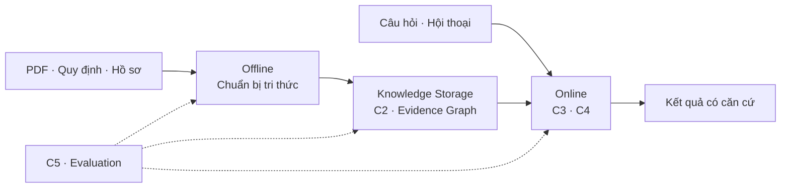
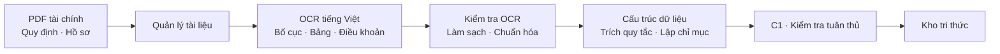
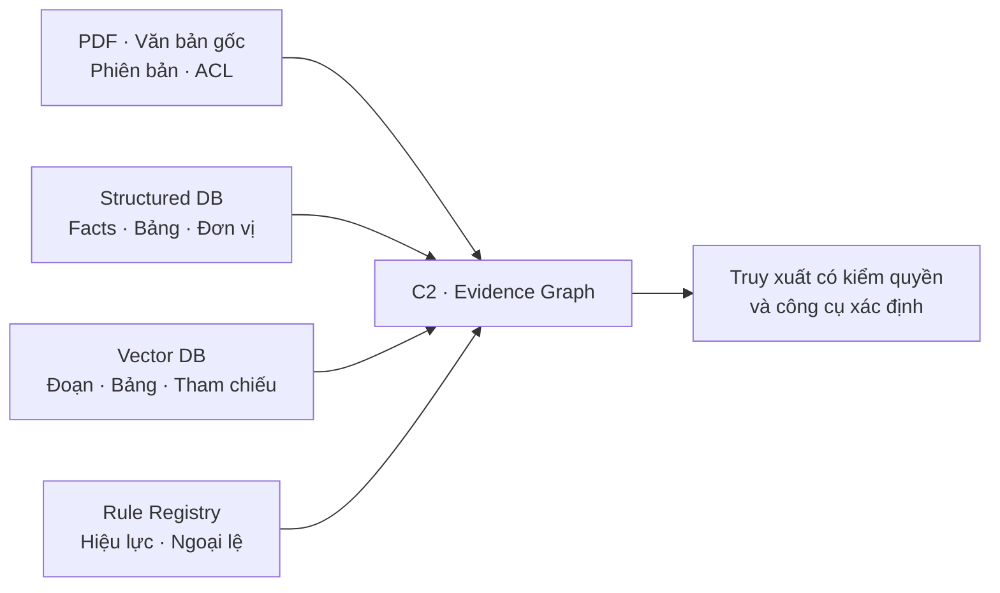
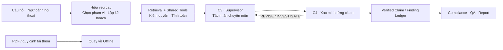
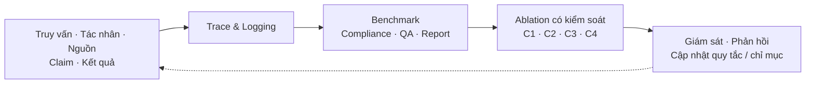

# Level 0 — Tổng quan hệ thống

> **Trạng thái:** kiến trúc mục tiêu đã thống nhất, không phải mô tả các thành phần đã triển khai. Chi tiết và lựa chọn công nghệ còn mở sẽ được ghi ở Level 1–2.

Hệ thống tiếp nhận nhiều báo cáo tài chính PDF, văn bản quy định (tùy chọn) và câu hỏi tiếng Việt. Mục tiêu là kiểm tra dữ liệu và tuân thủ, trả lời câu hỏi, rồi tạo báo cáo phân tích có căn cứ từ trang tài liệu và điều khoản áp dụng. Luồng chuẩn bị tài liệu chạy **Offline**; truy vấn và phân tích chạy **Online**. PDF tải lên trong phiên Online phải đi qua luồng Offline trước khi được truy xuất.

## Bản đồ Level 0

**C1–C5:** C1 kiểm tra tuân thủ theo ngữ cảnh trong Offline; C2 nối bằng chứng tài chính và quy định thành đồ thị có thể thực thi; C3 điều phối tác nhân theo nhu cầu bằng chứng và rủi ro; C4 xác minh từng claim/finding trước khi xuất; C5 đánh giá, ghi vết và hỗ trợ bảo trì. Các mục này đều thuộc kiến trúc mục tiêu.

## Offline — chuẩn bị tài liệu và kiểm tra tuân thủ

Quản lý tài liệu giữ bản gốc, metadata, hash/phiên bản và quyền truy cập. OCR tạo tham chiếu đến trang, bảng, ô và điều khoản. Kiểm tra chất lượng OCR tách khỏi kiểm tra nhất quán kế toán; chuẩn hóa số theo locale, đơn vị, kỳ, phạm vi hợp nhất, dấu, điều chỉnh hồi tố và ánh xạ chỉ tiêu VAS/IFRS trước khi so sánh hoặc tính toán.

**C1** kiểm tra cấu trúc, nhất quán kế toán và liên tài liệu, nghĩa vụ công bố, khả năng áp dụng quy định theo doanh nghiệp/kỳ/ngoại lệ, rồi phát hiện vi phạm với **hai nguồn gốc**: chứng cứ tài chính và điều khoản pháp lý. Dữ kiện có thể mang trạng thái `unknown` hoặc `needs_review`. Rủi ro tài chính không tự động là vi phạm pháp lý.

## Knowledge Storage — bằng chứng và trạng thái dùng chung

**C2** liên kết facts, chỉ số tính ra, quy tắc, claim, finding, trích dẫn và trạng thái xác minh. Cạnh đồ thị giữ tham chiếu đến PDF/trang/bảng/ô **và** văn bản/điều khoản quy định; phép tính và kiểm tra quy tắc có thể chạy lại. Bằng chứng nguồn được tạo khi nạp tài liệu; claim/finding và trạng thái xác minh xuất hiện trong lúc phân tích. Đổi phiên bản hoặc xử lý lại tài liệu có thể làm mất hiệu lực chỉ mục và claim phụ thuộc.

Quyền tenant/người dùng được kiểm tra tại truy xuất chunk, hàng dữ liệu, nút/cạnh đồ thị, quy tắc và metadata, bên cạnh ACL của tệp gốc. Phạm vi tài liệu, doanh nghiệp và kỳ phải đi cùng truy vấn để tránh trộn bằng chứng.

## Online — hỏi đáp, phân tích và đầu ra

Luồng Online phân giải hội thoại, xác định nhu cầu bằng chứng và chọn tài liệu/doanh nghiệp/kỳ/quy tắc trong phạm vi quyền. Công cụ dùng chung gồm truy xuất fact/chỉ số có kiểu, duyệt đồ thị, tìm đoạn và bảng, bộ tính và validator xác định; Text2SQL là phương án tùy chọn. **C3** điều phối tác nhân dữ liệu có cấu trúc, tuân thủ, phân tích diễn giải, tính toán, sinh lời, thanh khoản/đòn bẩy, dòng tiền/chất lượng lợi nhuận, giải quyết bằng chứng và tác nhân bổ sung khi cần; chia sẻ ngữ cảnh và giới hạn vòng điều tra lại.

**C4** chấm rủi ro và kiểm tra nguồn, số liệu, tính áp dụng pháp lý, logic tài chính, mức hỗ trợ của từng claim/finding. Quyết định là `ACCEPT`, `REVISE`, `INVESTIGATE` hoặc `ABSTAIN`. **Information firewall:** chỉ claim/finding đã xác minh trong ledger được dùng để tạo ba đầu ra riêng: kết quả tuân thủ (`violation` / `warning` / `unknown`), câu trả lời tương tác, báo cáo phân tích có bảng/biểu đồ và trích dẫn. Một nhận định tài chính, cảnh báo rủi ro và kết luận vi phạm phải được phân biệt; kết luận vi phạm còn cần quy định áp dụng và bằng chứng về hành vi vi phạm. Người dùng có thể tiếp tục hỏi theo ngữ cảnh.

## C5 — Evaluation, logging và bảo trì

C5 theo dõi độ đúng của phát hiện tuân thủ và khả năng áp dụng quy định, độ chính xác câu trả lời/số liệu/trích dẫn, tính thực chứng và hữu ích của báo cáo, hành vi abstain, hiệu năng và chi phí. Trace ghi truy vấn, hành động tác nhân, tài liệu/quy tắc được dùng, kết quả trung gian và đầu ra. Benchmark, ngưỡng và cách đo cụ thể: `TBD`; sơ đồ không hàm ý đã có kết quả đo.

## Ranh giới quyết định

- **Đã thống nhất:** đủ C1–C5, Offline/Online nối qua kho tri thức, kiểm quyền ở tầng truy xuất và dữ liệu, lưu phiên bản nguồn/quy tắc, xác minh ở mức claim và chỉ xuất từ ledger.
- **Chưa chốt (`TBD`):** phạm vi nguồn quy định, chính sách truy cập khi tải lên, ngưỡng định lượng, rubric xác minh, OCR engine, mô hình/VRAM, cách thực thi đồ thị và giao diện. Google Colab là môi trường tạo mẫu chính; lựa chọn công nghệ trong [PROJECT_CONTEXT](../context/PROJECT_CONTEXT.md) chỉ là khả năng, chưa phải cam kết.

## Tài liệu con dự kiến

Tài liệu ingestion đã được viết theo yêu cầu tiếp theo; các tài liệu còn lại vẫn là kế hoạch Level 1–2, **chưa có nội dung**:

| Level 1 | Phạm vi |
|---|---|
| [01-document-ingestion.md](01-document-ingestion.md) | Nạp tài liệu, OCR, chuẩn hóa, C1 — đã viết |
| [02-knowledge-and-graph.md](02-knowledge-and-graph.md) | Kho tri thức, quyền, phiên bản, C2 |
| [03-query-and-retrieval.md](03-query-and-retrieval.md) | Hội thoại, chọn phạm vi, retrieval, tools |
| [04-multi-agent.md](04-multi-agent.md) | C3, tác nhân, điều phối và hợp đồng dữ liệu |
| [05-verification-and-output.md](05-verification-and-output.md) | C4, ledger, firewall, ba loại đầu ra |
| [06-evaluation-monitoring.md](06-evaluation-monitoring.md) | C5, benchmark, trace, ablation, bảo trì |
| [07-implementation.md](07-implementation.md) | Hợp đồng dữ liệu, module, lộ trình triển khai, TBD |

Nguồn kiến trúc: [sơ đồ tham chiếu](../context/architecture-reference.png), [PROJECT_CONTEXT](../context/PROJECT_CONTEXT.md), [ARCHITECTURE_DECISIONS](../context/ARCHITECTURE_DECISIONS.md).
