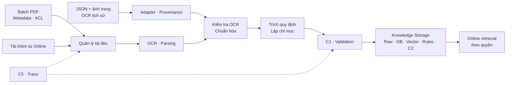
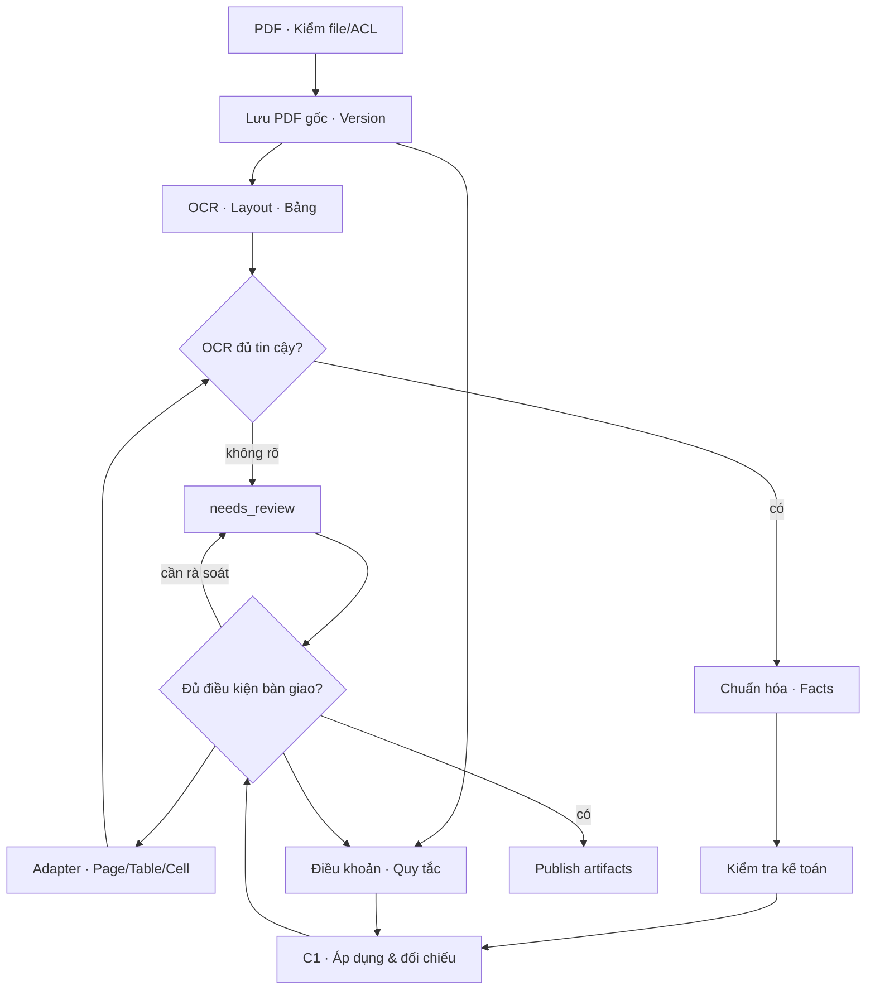
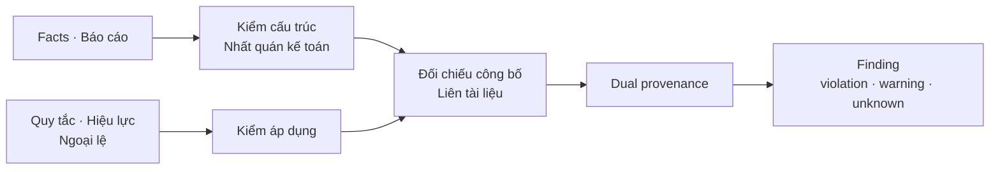
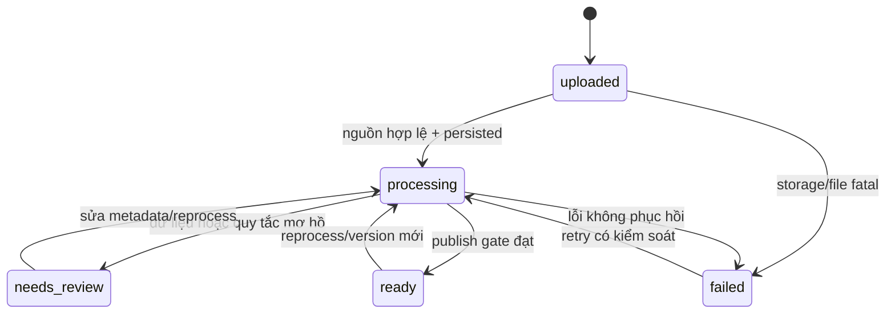

# Level 1 — Document Ingestion, OCR, Normalization và C1 Validation

**Loại tài liệu:** Technical Design Specification · **Trạng thái:** kiến trúc mục tiêu; đã triển khai và kiểm thử adapter OCR lịch sử cục bộ, các thành phần ingestion/C1 còn lại `Chưa xác nhận`  
**Tài liệu cha:** [Level 0](00-overview.md) · **Quy chuẩn:** [Technical Writing Standard](TECHNICAL_WRITING_STANDARD.md)  
**Liên quan:** [C2 và kho tri thức — dự kiến](02-knowledge-and-graph.md), [truy vấn và retrieval — dự kiến](03-query-and-retrieval.md), [C5 — dự kiến](06-evaluation-monitoring.md)

**Thiết kế và tiến độ bước quality:** [OCRQualityReport](01a-ocr-quality-report-plan.md).

**Cập nhật triển khai OCR quality:** đã có [validator v1](../financial_multiagent/ingestion/ocr_quality.py) và [notebook trong colab/](../colab/01_ocr_quality_report.ipynb). Validator đọc artifact adapter, ghi quality report versioned và không tự nâng document lên `ready`; normalization/regulation/C1 vẫn chưa triển khai. Bộ test Module 1 hiện đạt 41 passed, 2 skipped; kết quả/giới hạn lần chạy BTS local được ghi trong [kế hoạch quality](01a-ocr-quality-report-plan.md#9-acceptance-criteria-và-test-dự-kiến). Các số liệu kiểm thử adapter bên dưới là lịch sử của lần chạy trước.

## 1. Mục tiêu và trách nhiệm

**Luồng và mục đích.** Kiến trúc mục tiêu nhận nhiều PDF báo cáo tài chính và, khi được cung cấp, PDF/văn bản quy định cùng metadata hoặc validation profile; giữ nguyên bản gốc; tạo bằng chứng có tham chiếu nguồn; chuẩn hóa dữ liệu; chạy **C1 Context-Aware Regulatory Compliance Validation**; rồi bàn giao các artifact theo phiên bản cho Knowledge Storage. Tệp tải thêm trong phiên Online cũng quay vào luồng này trước khi được truy xuất (**Đã chốt — D03, D04**). **Đề xuất đường nhập dữ liệu lịch sử:** nhận bộ `page_x.json` và ảnh trang PNG đã OCR, giữ nguyên các artifact đó và đi vào cùng bước quality validation/normalization/C1 mà không chạy OCR lại.

| Ranh giới | Trách nhiệm |
|---|---|
| Đầu vào | Batch PDF tài chính hoặc bộ OCR lịch sử gồm JSON từng trang + ảnh trang; tài liệu quy định tùy chọn, metadata/profile, chủ thể và phạm vi quyền. |
| Module sở hữu | Kiểm tra tệp/bộ OCR; hash/duplicate/version; lưu nguồn gốc hiện có; OCR/layout/table/legal clause parsing cho PDF mới **hoặc** adapter cho OCR đã có; OCR quality validation; chuẩn hóa kế toán và văn bản pháp lý; trích điều khoản/quy tắc; C1; trạng thái ingestion và provenance nguồn. |
| Bàn giao | Raw object + metadata, OCRBlock/Table/FinancialFact/Regulation, chunks/index request, kết quả C1 và manifest phiên bản cho structured DB, vector DB, rule registry và C2. |
| Không sở hữu | C2 executable graph, truy xuất Online, C3 supervisor, C4 claim verification/verified ledger, đầu ra QA/report và benchmark C5. Các module đó tiêu thụ artifact đã bàn giao. |

**Invariant đã chốt:** PDF gốc phải được giữ khi đầu vào là PDF; bản gốc hiện có và tham chiếu trang/bảng/ô/điều khoản phải được giữ để kiểm toán (D04, D08). Bộ ảnh PNG tách từ PDF **không được ghi là PDF gốc**. Kiểm tra OCR khác kiểm tra nhất quán tài chính (D05); đơn vị, kỳ, phạm vi, dấu, restatement và ánh xạ chỉ tiêu được giữ tường minh (D06); C1 xét hiệu lực và ngoại lệ, finding pháp lý cần hai nguồn provenance (D10). Retrieval và database phải tự kiểm quyền, kể cả khi ingestion đã gắn ACL (D09). Rủi ro tài chính không tự động thành vi phạm.

**Trạng thái triển khai được xác nhận trong workspace:** `ocr_samples/ocr_pipeline.py` đã có code OCR; mẫu `ocr_samples/Financial_Report_OCR/BTS/2025/ocr_json/` có 37 JSON tương ứng 37 ảnh PNG trong `ocr_samples/Financial_OCR/BTS/2025/`. JSON giữ `page`, `elements`, `provenance`; bảng có `id`, `bbox`, `cells`, và ô có `id`, `row`, `col`, `text`, `bbox`. Mẫu chưa có PDF gốc, `document_id`, `document_version`, `source_ref` ở mức ô hoặc confidence ở mức text/ô. Đường dẫn crop trong JSON là đường dẫn Colab tuyệt đối. Đây là quan sát của **một mẫu BTS/2025**, không phải bảo đảm cho toàn bộ dữ liệu Drive.

**Đã triển khai — nhánh OCR lịch sử cục bộ:** `financial_multiagent/ingestion/precomputed_ocr.py` đọc JSON/PNG nguồn, kiểm đủ và liên tục các trang, metadata kích thước ảnh, ID và bbox; tạo `manifest.json` cùng `elements.jsonl` chứa `document_id`, `document_version`, `access_scope`, `source_ref` trang/phần tử/ô và ref ảnh/JSON tương đối với `source_root`. JSON/PNG nguồn không bị sửa. Thư mục đầu ra có thể là thư mục anh em của hai thư mục OCR trong cùng `source_root` (ví dụ `MyDrive/Financial_MultiAgent_Results/`), nhưng không được nằm trong hay bao trùm thư mục JSON, ảnh trang hoặc crop nguồn. Resolver cục bộ mở ảnh trang theo ref và so khớp `access_scope` do caller cung cấp. Đây **chưa phải** xác thực người dùng/tenant hay ACL của database/retrieval, chưa có resolver Drive API, chưa chạy OCR quality scoring, financial validation, regulation extraction hoặc C1. Manifest giữ `ingestion_status=processing`, không đánh dấu `ready`.

**Đề xuất:** mô hình job theo từng `document_id` trong một `batch_id`, bản gốc bất biến theo hash, các bước xử lý có checkpoint. Điều này cho phép chạy lại khi Colab reset và tránh một PDF lỗi làm hỏng cả batch. **TBD:** upload access policy, danh mục quy định, ngưỡng chất lượng, metric ontology, định nghĩa chính xác của cổng `ready` và công nghệ lưu trữ/OCR.

## 2. Kiến trúc và sơ đồ Mermaid

### Level 1 — vị trí trong hệ thống



Luồng kết thúc ở bàn giao có kiểm tra quyền và phiên bản. C2 nhận evidence nguồn; claim và quyết định C4 chỉ xuất hiện ở runtime.

### Level 2 — các sub-pipeline và cổng chất lượng



Đường PDF mới chạy OCR; đường JSON + PNG đã có dùng adapter và **không OCR lại**. Cả hai gặp nhau trước OCR quality validation. Đường trích quy định chạy theo loại tài liệu; C1 chỉ tạo kết luận pháp lý khi có điều khoản áp dụng và chứng cứ tài chính tương ứng. `needs_review` giữ nguồn gốc hiện có và kết quả từng phần, không xuất bản chúng như bằng chứng đáng tin cậy.

### Level 2 — riêng C1 validation



**C1** kiểm tra dữ kiện và điều kiện áp dụng bằng phép tính/validator xác định. `unknown` là kết quả hợp lệ khi nguồn, điều khoản hoặc độ tin cậy không đủ; C1 không thay thế C4 kiểm chứng claim trong Online.

## 3. Workflow theo từng bước

| Bước | Thành phần và hành động | Đọc → ghi | Điều kiện chuyển / dừng |
|---|---|---|---|
| 1 | `BatchUploadService` hoặc `PrecomputedOcrImporter` nhận input và identity; kiểm tra quyền theo policy. | PDF **hoặc** manifest JSON + PNG, metadata, `access_scope` → `batch_id`, receipt. | Không có quyền: từ chối trước khi lộ hash/metadata của scope khác. Policy cụ thể `TBD`. |
| 2 | `FileValidator` kiểm PDF; `OCRBundleValidator` kiểm đủ JSON/ảnh, số trang duy nhất, cấu trúc và tọa độ hợp lệ. | Input → validation result theo từng tài liệu. | Tệp hỏng/thiếu trang hoặc ảnh: `failed`/`needs_review` theo khả năng khôi phục; giới hạn `TBD`. |
| 3 | `DocumentRegistry` xác định logical document/version và dò trùng trong scope được phép. | PDF: hash bytes; bộ OCR: hash/manifest của artifact hiện có + metadata → ID/version/duplicate relation. | **Không** dùng hash PNG/JSON làm hash PDF. Cách gán `document_version` khi chưa có PDF gốc `TBD`; phải ghi `source_format`. |
| 4 | `RawDocumentStore` lưu bất biến PDF gốc nếu có; với bộ lịch sử, lưu/định vị JSON và ảnh PNG hiện có cùng manifest, ACL và receipt. | Nguồn hiện có → source URI/checkpoint; job `uploaded → processing`. | Không có PDF gốc: `original_pdf_ref = null`, không tạo PDF giả từ PNG. Lỗi lưu tạm thời: retry an toàn. |
| 5 | `OCRParser` xử lý PDF mới; **hoặc** `PrecomputedOcrAdapter` đọc `page_x.json` không sửa nội dung, ánh xạ block/bảng/ô và đường dẫn crop sang asset ref tương đối. | Raw version hoặc OCR bundle → `OCRBlock`, `Table`, cell, legal blocks + `source_ref`. | Mỗi ref chứa document/version/trang/bảng/ô khi phù hợp; PDF page mapping từ ảnh lịch sử còn `TBD`. |
| 6 | `OCRQualityValidator` đánh giá độ phủ trang, khả năng đọc, thứ tự/layout, bảng/ô, ký tự/số bất thường; lưu issue theo nguồn. | OCR artifacts → OCR quality report. | `confidence` có thể vắng mặt trong JSON lịch sử; không tự coi thiếu score là OCR sai, dùng các phép kiểm có dữ liệu và để ngưỡng `TBD`. Không dùng kiểm tra kế toán để che lỗi OCR. |
| 7 | `FinancialNormalizer` chuẩn hóa locale, dấu, tiền tệ/đơn vị, kỳ, phạm vi hợp nhất, restatement và mapping VAS/IFRS; giữ text/value gốc. | OCR/table cells → `FinancialFact`. | Mơ hồ ở đơn vị/kỳ/phạm vi: fact `needs_review`, không tự chọn. |
| 8 | `RegulationExtractor` chuẩn hóa điều/khoản, trích điều kiện áp dụng, ngoại lệ, ngày hiệu lực và tham chiếu; tạo provision chunks/index request. | Legal blocks → `Regulation` candidate + rule extraction report. | Không rõ hiệu lực/ngoại lệ: `unknown`/`needs_review`, không suy ra quy tắc. |
| 9 | `FinancialConsistencyValidator` chạy phép kiểm cấu trúc bảng, tổng/phần, đối chiếu cùng kỳ, liên tài liệu bằng số xác định; `C1Validator` kiểm công bố, tính áp dụng và hành vi vi phạm. | Facts + regulations + profile → check results + C1 findings. | Financial discrepancy tạo issue/risk evidence; chỉ có violation nếu có quy tắc áp dụng và dual provenance. |
| 10 | `ArtifactPublisher` bàn giao raw manifest, facts, chunks/index requests, rule candidates và C1 results; xác nhận downstream trước khi đánh dấu trạng thái. | Versioned artifacts → kho tri thức/C2, trace C5. | `ready` chỉ khi đạt cổng publish và kiểm quyền; định nghĩa các ack bắt buộc `TBD`. Nếu không, giữ `processing`/`needs_review` hoặc `failed` theo lỗi. |

Batch có kết quả theo từng tệp/bộ OCR; trạng thái batch được tổng hợp từ các tài liệu (**Đề xuất**). Reprocess một version tạo `processing_run_id` mới, giữ nguồn gốc hiện có và đánh dấu artifact phụ thuộc cũ cần xét vô hiệu hóa ở structured/vector/rule registry/C2 và claim/citation downstream (**Đã chốt về yêu cầu versioning/invalidation; cơ chế cụ thể Đề xuất**). Chỉ triển khai adapter và test trên mẫu BTS/2025 là **giai đoạn triển khai đề xuất**, không có nghĩa C1–C5 bị loại khỏi kiến trúc mục tiêu.

## 4. Component I/O contracts và JSON schemas minh họa

**Tất cả tên trường, kiểu và định dạng ID dưới đây là Đề xuất**, trừ nội dung ngữ nghĩa bắt buộc từ D04–D10. JSON Schema dùng Draft 2020-12. Ví dụ chứa dữ liệu giả để minh họa contract, không phải số liệu thực tế hay quy định pháp lý đã được xác nhận. Số liệu ô BTS/2025 ở ví dụ riêng bên dưới là text OCR đã quan sát, chưa phải fact tài chính đã xác minh.

| Contract | Producer → consumer | Input/Output tối thiểu | Quyền, phiên bản và lỗi |
|---|---|---|---|
| `Document` | Upload/registry → raw store, parser, Knowledge Storage | ID/version, kind, `source_format`, PDF hash/ref **nếu có**, source manifest, metadata, `access_scope`, status | Kiểm quyền trước duplicate lookup; giữ nguồn gốc; không khai PNG là PDF. |
| `OCRBundle` | Colab/Drive hoặc import local → adapter | symbol/year, danh sách trang, JSON ref, PNG ref, PDF ref tùy chọn, ACL/manifest version | Kiểm scope và tính toàn vẹn; đường dẫn Colab chỉ là địa chỉ nguồn, không là ID bền vững. |
| `OCRBlock` | OCR/parser hoặc adapter → quality, normalizer, vector indexing | ID, document version, page, text, bbox, confidence tùy chọn, `source_ref` | Kế thừa ACL; score vắng mặt là `null`, không suy ra score; source page bắt buộc. |
| `Table` | Parser → normalizer, C1, vector indexing | ID, document version, page, cells với row/column/source | Kế thừa ACL; cell không xác định → review. |
| `FinancialFact` | Normalizer → structured DB, C1, C2 | Metric, company, period, scope, giá trị/đơn vị gốc và chuẩn hóa, source | Kế thừa ACL + version; đơn vị/kỳ mơ hồ → review. |
| `Regulation` | RegulationExtractor → rule registry, C1, C2 | Rule/version, điều khoản, hiệu lực, điều kiện/ngoại lệ, source | Kế thừa ACL + rule/document version; không rõ áp dụng → unknown. |
| `C1ValidationResult` | C1 → structured DB/C2 và trace C5 | Check, outcome, tài liệu/fact/rule refs, dual provenance, reason | Violation yêu cầu finance + legal ref; không có đủ bằng chứng → unknown. |

### Ví dụ JSON — một version và artifact liên quan

```json
{
  "document": {
    "document_id": "doc-report-01",
    "document_version": "v1",
    "kind": "financial_report",
    "source_format": "pdf",
    "sha256": "aaaaaaaaaaaaaaaaaaaaaaaaaaaaaaaaaaaaaaaaaaaaaaaaaaaaaaaaaaaaaaaa",
    "raw_uri": "raw://tenant-a/doc-report-01/v1",
    "source_manifest_ref": null,
    "company_id": "COMPANY_A",
    "fiscal_period": "2024-FY",
    "consolidation_scope": "consolidated",
    "access_scope": "tenant-a",
    "status": "processing"
  },
  "ocr_block": {
    "block_id": "block-7",
    "document_id": "doc-report-01",
    "document_version": "v1",
    "page": 12,
    "text": "Doanh thu thuần",
    "bbox": [10, 20, 200, 44],
    "confidence": 0.96,
    "source_ref": "doc-report-01/v1/p12",
    "access_scope": "tenant-a"
  },
  "table": {
    "table_id": "table-2",
    "document_id": "doc-report-01",
    "document_version": "v1",
    "page": 12,
    "cells": [{"row": 3, "column": 2, "text": "1.234", "source_ref": "doc-report-01/v1/p12/t2/r3c2"}],
    "access_scope": "tenant-a"
  },
  "financial_fact": {
    "fact_id": "fact-1",
    "document_id": "doc-report-01",
    "document_version": "v1",
    "company_id": "COMPANY_A",
    "fiscal_period": "2024-FY",
    "consolidation_scope": "consolidated",
    "metric_code": "revenue_net",
    "raw_value": "1.234",
    "value": "1234",
    "unit": "million_VND",
    "source_ref": "doc-report-01/v1/p12/t2/r3c2",
    "access_scope": "tenant-a",
    "quality_state": "accepted"
  },
  "regulation": {
    "rule_id": "rule-example-1",
    "rule_version": "v1",
    "document_id": "doc-legal-01",
    "document_version": "v1",
    "article_ref": "article-example",
    "effective_from": null,
    "effective_to": null,
    "applicability": "unknown",
    "exceptions": [],
    "source_ref": "doc-legal-01/v1/p2/article-example",
    "access_scope": "tenant-a",
    "quality_state": "needs_review"
  },
  "c1_validation_result": {
    "check_id": "check-1",
    "outcome": "unknown",
    "fact_ids": ["fact-1"],
    "rule_id": "rule-example-1",
    "rule_version": "v1",
    "financial_source_refs": ["doc-report-01/v1/p12/t2/r3c2"],
    "legal_source_refs": ["doc-legal-01/v1/p2/article-example"],
    "reason": "Chưa xác nhận hiệu lực và điều kiện áp dụng"
  }
}
```

**Ví dụ riêng cho bộ OCR lịch sử BTS/2025 (Đề xuất manifest; chỉ một trang minh họa):**

```json
{
  "source_format": "page_images",
  "symbol": "BTS",
  "report_year": "2025",
  "document_id": "BTS-2025-report",
  "document_version": "ocr-bundle-version-TBD",
  "original_pdf_ref": null,
  "access_scope": "demo-scope",
  "pages": [{
    "page_number": 12,
    "ocr_json_ref": "Financial_Report_OCR/BTS/2025/ocr_json/page_12.json",
    "page_image_ref": "Financial_OCR/BTS/2025/page_12.png"
  }],
  "example_cell": {
    "table_id": "table_001",
    "cell_id": "table_001_cell_009",
    "row": 1,
    "col": 3,
    "text": "2.818.277.552.061",
    "bbox": [1509, 757, 1856, 795],
    "source_ref": "BTS-2025-report/ocr-bundle-version-TBD/p12/table_001/table_001_cell_009"
  }
}
```

Manifest thực tế phải liệt kê **đủ 37 trang**; `demo-scope`, ID và version trên chỉ minh họa, không suy ra ACL hoặc phiên bản PDF từ tên thư mục. `source_ref` phải gồm trang vì `table_001`/`cell_...` có thể lặp giữa các trang. JSON gốc và ảnh gốc giữ nguyên; đường dẫn Colab tuyệt đối ở `crop` được ánh xạ thành `asset_ref` tương đối khi đọc. `raw_value` và `value` là chuỗi thập phân để tránh sai số nhị phân (**Đề xuất**); `unit` phải chỉ rõ cấp độ (đồng, nghìn, triệu...) và tiền tệ. `confidence` là tín hiệu OCR nếu có, không phải xác suất đúng của fact hay kết luận pháp lý. `effective_from/to = null` nghĩa là **chưa xác định**, không có nghĩa hiệu lực vô hạn. `source_ref` dạng chuỗi là cách viết ngắn; hợp đồng cuối có thể dùng object typed (**TBD**).

### JSON Schema rút gọn cho hai nguồn nhập, năm entity bắt buộc và kết quả C1

```json
{
  "$schema": "https://json-schema.org/draft/2020-12/schema",
  "$defs": {
    "Document": {
      "type": "object",
      "required": ["document_id", "document_version", "kind", "source_format", "sha256", "raw_uri", "source_manifest_ref", "access_scope", "status"],
      "properties": {
        "document_id": {"type": "string"},
        "document_version": {"type": "string"},
        "kind": {"enum": ["financial_report", "regulation"]},
        "source_format": {"enum": ["pdf", "page_images"]},
        "sha256": {"type": ["string", "null"]},
        "raw_uri": {"type": ["string", "null"]},
        "source_manifest_ref": {"type": ["string", "null"]},
        "company_id": {"type": ["string", "null"]},
        "fiscal_period": {"type": ["string", "null"]},
        "consolidation_scope": {"type": ["string", "null"]},
        "access_scope": {"type": "string"},
        "status": {"enum": ["uploaded", "processing", "needs_review", "ready", "failed"]}
      }
    },
    "OCRBundle": {
      "type": "object",
      "required": ["source_format", "symbol", "report_year", "document_id", "document_version", "original_pdf_ref", "access_scope", "pages"],
      "properties": {
        "source_format": {"const": "page_images"},
        "symbol": {"type": "string"},
        "report_year": {"type": "string"},
        "document_id": {"type": "string"},
        "document_version": {"type": "string"},
        "original_pdf_ref": {"type": ["string", "null"]},
        "access_scope": {"type": "string"},
        "pages": {"type": "array", "minItems": 1, "items": {"type": "object", "required": ["page_number", "ocr_json_ref", "page_image_ref"], "properties": {"page_number": {"type": "integer", "minimum": 1}, "ocr_json_ref": {"type": "string"}, "page_image_ref": {"type": "string"}}}}
      }
    },
    "OCRBlock": {
      "type": "object",
      "required": ["block_id", "document_id", "document_version", "page", "text", "source_ref", "access_scope"],
      "properties": {
        "block_id": {"type": "string"},
        "document_id": {"type": "string"},
        "document_version": {"type": "string"},
        "page": {"type": "integer", "minimum": 1},
        "text": {"type": "string"},
        "bbox": {"type": "array", "items": {"type": "number"}, "minItems": 4, "maxItems": 4},
        "confidence": {"type": ["number", "null"], "minimum": 0, "maximum": 1},
        "source_ref": {"type": "string"},
        "access_scope": {"type": "string"}
      }
    },
    "Table": {
      "type": "object",
      "required": ["table_id", "document_id", "document_version", "page", "cells", "access_scope"],
      "properties": {
        "table_id": {"type": "string"},
        "document_id": {"type": "string"},
        "document_version": {"type": "string"},
        "page": {"type": "integer", "minimum": 1},
        "cells": {"type": "array", "items": {"type": "object", "required": ["row", "column", "text", "source_ref"], "properties": {"row": {"type": "integer"}, "column": {"type": "integer"}, "text": {"type": "string"}, "source_ref": {"type": "string"}}}},
        "access_scope": {"type": "string"}
      }
    },
    "FinancialFact": {
      "type": "object",
      "required": ["fact_id", "document_id", "document_version", "company_id", "fiscal_period", "consolidation_scope", "metric_code", "raw_value", "value", "unit", "source_ref", "access_scope", "quality_state"],
      "properties": {
        "fact_id": {"type": "string"},
        "document_id": {"type": "string"},
        "document_version": {"type": "string"},
        "company_id": {"type": "string"},
        "fiscal_period": {"type": "string"},
        "consolidation_scope": {"type": "string"},
        "metric_code": {"type": "string"},
        "raw_value": {"type": "string"},
        "value": {"type": "string"},
        "unit": {"type": "string"},
        "source_ref": {"type": "string"},
        "access_scope": {"type": "string"},
        "quality_state": {"enum": ["accepted", "needs_review"]}
      }
    },
    "Regulation": {
      "type": "object",
      "required": ["rule_id", "rule_version", "document_id", "document_version", "article_ref", "effective_from", "effective_to", "applicability", "exceptions", "source_ref", "access_scope", "quality_state"],
      "properties": {
        "rule_id": {"type": "string"},
        "rule_version": {"type": "string"},
        "document_id": {"type": "string"},
        "document_version": {"type": "string"},
        "article_ref": {"type": "string"},
        "effective_from": {"type": ["string", "null"], "format": "date"},
        "effective_to": {"type": ["string", "null"], "format": "date"},
        "applicability": {"type": "string"},
        "exceptions": {"type": "array", "items": {"type": "string"}},
        "source_ref": {"type": "string"},
        "access_scope": {"type": "string"},
        "quality_state": {"enum": ["accepted", "needs_review"]}
      }
    },
    "C1ValidationResult": {
      "type": "object",
      "required": ["check_id", "outcome", "fact_ids", "financial_source_refs", "legal_source_refs", "reason"],
      "properties": {
        "check_id": {"type": "string"},
        "outcome": {"enum": ["pass", "violation", "warning", "unknown", "needs_review"]},
        "fact_ids": {"type": "array", "items": {"type": "string"}},
        "rule_id": {"type": ["string", "null"]},
        "rule_version": {"type": ["string", "null"]},
        "financial_source_refs": {"type": "array", "items": {"type": "string"}},
        "legal_source_refs": {"type": "array", "items": {"type": "string"}},
        "reason": {"type": "string"}
      },
      "allOf": [{"if": {"properties": {"outcome": {"const": "violation"}}}, "then": {"required": ["rule_id", "rule_version"], "properties": {"financial_source_refs": {"minItems": 1}, "legal_source_refs": {"minItems": 1}}}}]
    }
  }
}
```

**Schema cần bổ sung trước khi lập trình:** tính duy nhất của ID, cú pháp `source_ref`, hash SHA-256 thực, cách xác định `document_version` khi chỉ có bộ ảnh/JSON, đơn vị chuẩn, calendar/kỳ tài chính, taxonomy `metric_code`, enum phạm vi hợp nhất, tọa độ bbox, và cách biểu diễn rule applicability/exception có thể thực thi đều `TBD`. Với `source_format = pdf`, `sha256`/`raw_uri` phải hiện diện trước publish; với `page_images`, `sha256` của PDF là `null` khi PDF không có và `source_manifest_ref` phải hiện diện. Schema rút gọn chưa mã hóa các điều kiện đó hoặc ràng buộc liên entity; service phải kiểm rằng mọi artifact cùng `document_id`/`document_version` và cùng `access_scope` với nguồn đã đăng ký. Riêng `C1ValidationResult`, JSON Schema chỉ kiểm có refs; service còn phải xác nhận rule thực sự áp dụng, refs mở được và `rule_id`/`rule_version` không null trước khi ghi `violation`.

## 5. Database tables và cấu trúc dữ liệu

**Đề xuất logical schema**; DB engine và kiểu vật lý `TBD`. Khóa ghép `(document_id, document_version)` được dùng trong toàn bộ artifact để tránh trộn lần xử lý. `document_version` của bộ ảnh/JSON là phiên bản **nguồn hiện có**, không được mô tả là phiên bản PDF. Cột `access_scope` minh họa; mô hình ACL cụ thể `TBD`.

| Kho / bảng | Khóa, cột chính và index | Ghi, đọc và invariant |
|---|---|---|
| Raw store `raw_object` | PK `raw_object_id`; `sha256`, URI, size, media_type, ACL/version; index hash trong scope. | Ingestion ghi PDF gốc khi có; với dữ liệu lịch sử giữ nguyên JSON/PNG nguồn. URI không cấp quyền tự thân; mở tệp phải kiểm ACL. |
| Structured DB `document` | PK `(document_id, document_version)`; kind, metadata, raw object FK, status, `access_scope`, created/updated; index scope/status/company/period. | Registry ghi; nguồn chân lý của version/status; metadata thay đổi có provenance. |
| Structured DB `source_asset` | PK `(document_id,document_version,page_number,asset_kind)`; URI/ref, hash, kích thước, ACL. | Ánh xạ trang JSON/PNG/crop; phân biệt ảnh nguồn với PDF gốc, giữ source path tương đối và path resolver. |
| Structured DB `ingestion_job` | PK `(batch_id, document_id, document_version, processing_run_id)`; stage, checkpoint, attempts, error_code, trace ID. | Orchestrator ghi; retry không tạo artifact trùng; batch status tổng hợp. |
| Structured DB `ocr_block` | PK `block_id`; FK document version; page, bbox, text, confidence, source_ref, quality state, `access_scope`; index document/page. | Parser ghi; không ghi đè âm thầm khi re-OCR: gắn run/version. |
| Structured DB `parsed_table` / `table_cell` | PK `table_id` / `(table_id,row,column)`; FK document version; page, value/text, source_ref, `access_scope`. | Parser ghi; mỗi cell trace được về PDF/page; ô gộp và tọa độ `TBD`. |
| Structured DB `financial_fact` | PK `fact_id`; FK document version + cell/block; company, fiscal period, scope, metric, raw/normalized value, unit, quality state, `access_scope`; index scope/company/period/metric. | Normalizer ghi; giữ giá trị gốc và chuẩn hóa, không dùng fact review như đã xác nhận. |
| Rule registry `regulation_provision` | PK `(rule_id,rule_version)`; FK legal document version; article, effective dates, applicability, exceptions, source_ref, quality state, `access_scope`; index hiệu lực/scope. | Extractor ghi candidate; rule chưa rõ hiệu lực không được xem là đang áp dụng. |
| Structured DB `c1_validation_result` | PK `check_id`; document/fact/rule versions, outcome, financial/legal refs, reason, run ID, `access_scope`. | C1 ghi; violation bắt buộc có dual provenance và applicability; lưu `unknown`/review. |
| Vector DB `source_chunk` | PK chunk ID + document version/run; text/table/legal ref, embedding version, ACL metadata. | Ingestion phát index request; Knowledge Storage sở hữu index. Retrieval kiểm quyền lại, không dựa riêng vào filter ở vector DB. |
| C2 graph source nodes/edges | Versioned fact/rule/source refs; edge phụ thuộc và ACL. | C2 sở hữu xây đồ thị thực thi; ingestion chỉ bàn giao nguồn/provenance và invalidation event. |

**Data dictionary rút gọn (Đề xuất):** `!` = bắt buộc, `?` = nullable; `TEXT`, `INTEGER`, `DECIMAL_TEXT`, `DATE`, `JSON` là kiểu logic, không áp đặt DB engine. Mọi bảng có `access_scope:TEXT!` hoặc ACL tương đương; FK tới document luôn gồm cả ID và version. Index và unique vật lý cần xác nhận theo engine.

| Cấu trúc | Cột/trường chính, kiểu và nullability | Khóa/quan hệ/index cần giữ |
|---|---|---|
| `raw_object` | `raw_object_id:TEXT!`, `sha256:TEXT!`, `uri:TEXT!`, `size_bytes:INTEGER!`, `media_type:TEXT!`, `access_scope:TEXT!` | PK ID; unique `(access_scope,sha256)` chỉ nếu policy dedup cho phép; ACL khi đọc. |
| `document` | `document_id:TEXT!`, `document_version:TEXT!`, `kind:TEXT!`, `source_format:TEXT!`, `raw_object_id:TEXT?`, `source_manifest_ref:TEXT?`, `company_id:TEXT?`, `fiscal_period:TEXT?`, `consolidation_scope:TEXT?`, `status:TEXT!`, `access_scope:TEXT!` | PK `(ID,version)`; FK raw nếu là PDF. `raw_object_id` có thể null ở `page_images`; khi đó cần manifest + source assets. Index scope/status/company/period. |
| `source_asset` | `document_id:TEXT!`, `document_version:TEXT!`, `page_number:INTEGER!`, `asset_kind:TEXT!`, `source_path:TEXT!`, `content_hash:TEXT!`, `access_scope:TEXT!` | PK `(doc,version,page,kind)`; FK document; `asset_kind` phân biệt `ocr_json`/`page_png`/crop. Crop nhiều ảnh cần thêm `asset_id` (**TBD**). |
| `ingestion_job` | `batch_id:TEXT!`, `document_id:TEXT!`, `document_version:TEXT!`, `processing_run_id:TEXT!`, `stage:TEXT!`, `attempts:INTEGER!`, `error_code:TEXT?`, `checkpoint:JSON?`, `access_scope:TEXT!` | PK batch/doc/version/run; FK document; index stage/scope. |
| `ocr_block` | `block_id:TEXT!`, `document_id:TEXT!`, `document_version:TEXT!`, `processing_run_id:TEXT!`, `page:INTEGER!`, `bbox:JSON?`, `text:TEXT!`, `confidence:DECIMAL_TEXT?`, `source_ref:TEXT!`, `quality_state:TEXT!`, `access_scope:TEXT!` | PK block; FK document; unique `(doc,version,run,page,block_id)`; index doc/page. |
| `parsed_table` | `table_id:TEXT!`, `document_id:TEXT!`, `document_version:TEXT!`, `processing_run_id:TEXT!`, `page:INTEGER!`, `source_ref:TEXT!`, `access_scope:TEXT!` | PK table; FK document; index doc/page. |
| `table_cell` | `table_id:TEXT!`, `row:INTEGER!`, `column:INTEGER!`, `text:TEXT!`, `source_ref:TEXT!`, `access_scope:TEXT!` | PK `(table_id,row,column)`; FK table; merged-cell representation `TBD`. |
| `financial_fact` | `fact_id:TEXT!`, `document_id:TEXT!`, `document_version:TEXT!`, `company_id:TEXT!`, `fiscal_period:TEXT!`, `consolidation_scope:TEXT!`, `metric_code:TEXT!`, `raw_value:TEXT!`, `value:DECIMAL_TEXT!`, `unit:TEXT!`, `source_ref:TEXT!`, `quality_state:TEXT!`, `access_scope:TEXT!` | PK fact; FK document/source; index scope/company/period/metric. |
| `regulation_provision` | `rule_id:TEXT!`, `rule_version:TEXT!`, `document_id:TEXT!`, `document_version:TEXT!`, `article_ref:TEXT!`, `effective_from:DATE?`, `effective_to:DATE?`, `applicability:JSON?`, `exceptions:JSON?`, `source_ref:TEXT!`, `quality_state:TEXT!`, `access_scope:TEXT!` | PK `(rule_id,rule_version)`; FK legal document; index hiệu lực/scope. `null` hiệu lực = chưa xác định. |
| `c1_validation_result` | `check_id:TEXT!`, `document_id:TEXT!`, `document_version:TEXT!`, `processing_run_id:TEXT!`, `rule_id:TEXT?`, `rule_version:TEXT?`, `outcome:TEXT!`, `financial_refs:JSON!`, `legal_refs:JSON!`, `reason:TEXT!`, `access_scope:TEXT!` | PK check; FK document và rule nếu có; index document/outcome. |
| `source_chunk` | `chunk_id:TEXT!`, `document_id:TEXT!`, `document_version:TEXT!`, `processing_run_id:TEXT!`, `text:TEXT!`, `source_ref:TEXT!`, `embedding_version:TEXT?`, `access_scope:TEXT!` | Unique chunk/version/run; index/filter scope và source; retrieval kiểm ACL lại. |
| C2 node/edge bàn giao | `source_id:TEXT!`, `source_version:TEXT!`, `source_ref:TEXT!`, `access_scope:TEXT!`, `depends_on:JSON?` | Graph owner xác lập PK/cạnh; ingestion gửi versioned refs, không tự tạo claim runtime. |

**Lifecycle:** raw PDF/legal original được giữ khi đầu vào có chúng; với bộ lịch sử chỉ có JSON/PNG, giữ chính JSON/PNG như artifact nguồn hiện có, ghi `original_pdf_ref = null` và không gán hash PNG cho PDF. Thời hạn giữ và chính sách xóa `TBD`. Khi version, rule hoặc run thay đổi, phát `artifact_invalidated` (**Đề xuất contract**) cho structured/vector/C2 và ledger downstream; chỉ bản được phép và còn hiệu lực mới được retrieval thấy. Không cho phép nối fact của kỳ/doanh nghiệp/phạm vi khác nếu không có phép so sánh được ghi rõ.

## 6. Functions, classes, APIs và tools cần phát triển

Các chữ ký là **Đề xuất giao diện**, không phải mã nguồn. `AccessContext` phải đi cùng các thao tác có I/O; quyền được kiểm lại ở tầng lưu trữ và retrieval (D09). Timeout/retry budget đều `TBD`.

| Loại / giao diện | Input → output; side effect | Quyền, idempotency và lỗi |
|---|---|---|
| API `submit_batch(files, metadata, access_context, idempotency_key)` | Upload → batch receipt, per-file document refs; tạo job. | Kiểm upload; cùng key/scope không tạo job trùng; `FORBIDDEN`, `INVALID_FILE`, `CONFLICT`. |
| API `get_ingestion_status(batch_id, access_context)` | Batch ID → trạng thái từng document + stage/issue an toàn để hiển thị. | Kiểm scope trước khi đọc; không lộ hash hoặc metadata tenant khác. |
| Service `FileValidator.validate(file, profile)` | Bytes/metadata → validation result, không side effect. | Kiểm format/limits; `INVALID_FILE`; limits `TBD`. |
| Service `DocumentRegistry.register(file_hash, metadata, scope)` | Hash/metadata → document version/duplicate relation; ghi metadata. | Dò trùng chỉ trong phạm vi được phép; idempotent theo upload key. |
| Service `RawDocumentStore.put(original, version, scope)` | Bytes → raw URI/receipt; ghi bất biến. | Ghi lại cùng hash/version cho cùng receipt là idempotent; storage failure retry. |
| Service `OCRParser.parse(raw_ref, run_id)` | Raw PDF → OCRBlock/Table/legal blocks; ghi/checkpoint. | Không làm mất source page; lỗi engine/layout → review hoặc retry. |
| Service `OCRBundleValidator.validate(manifest, access_context)` | JSON/PNG refs → page coverage, ID/bbox/path issues; không sửa JSON gốc. | Kiểm ACL trước khi đọc; thiếu trang/ảnh, JSON sai hoặc bbox ngoài ảnh → issue có page ref. |
| Service `PrecomputedOcrAdapter.load(manifest, run_id, access_context)` | `page_x.json` + ảnh trang → `OCRBlock`/`Table`/cell/source assets với `source_ref` ổn định; ghi checkpoint. | Không gọi OCR engine; xử lý từng trang, idempotent theo source version/run; không suy ra PDF hash/ACL từ tên thư mục. |
| Service `SourceAssetResolver.resolve(source_ref, access_context)` | Ref logic → JSON/ảnh/crop trên local/Drive/storage; không đổi ref khi đổi môi trường. | Kiểm ACL ở tầng dữ liệu; đường dẫn Colab tuyệt đối được ánh xạ sang ref tương đối, không công bố path nội bộ. |
| Pure tool `OCRQualityValidator.assess(manifest, records, profile)` | Artifact adapter → `OCRQualityReport` với metrics/checks/issues; đã có code v1. | Ngưỡng cần hiệu chỉnh; không đọc kết quả kế toán làm proxy. |
| Pure tool `FinancialNormalizer.normalize(cells, metadata, ontology)` | Cells → FinancialFact candidates/issues. | Giữ raw value; ambiguous unit/period → review. |
| Service `RegulationExtractor.extract(legal_blocks, profile)` | Điều/khoản → Regulation candidates/chunks. | Không suy diễn hiệu lực; thiếu thông tin → unknown/review. |
| Pure tool `FinancialConsistencyValidator.check(facts, statements)` | Facts → structural/accounting/cross-document checks. | Tính bằng logic xác định, kiểm kỳ/đơn vị/scope trước phép tính. |
| Service `C1Validator.validate(facts, rules, profile)` | Facts + rule versions → C1 results; ghi check trace. | Kiểm applicability/effective dates/exceptions; violation cần dual provenance. |
| Service `ArtifactPublisher.publish(manifest, access_context)` | Artifacts → per-store receipts + availability status. | Ghi có phiên bản và idempotent; chỉ nâng `ready` sau ack bắt buộc `TBD`. |

Tool C3 về fact/metric, graph, semantic retrieval và calculator được thiết kế ở module Online; ingestion chỉ sản sinh input có kiểu và provenance cho các tool đó. C5 nhận trace từ mỗi stage; không ghi thông tin nhạy cảm vượt ACL trong log.

## 7. Trạng thái, lỗi, retry và phục hồi

### State machine đề xuất



`ready` không đồng nghĩa mọi compliance check đều `violation`/`pass`: `unknown` có thể tồn tại nếu nguồn quy định tùy chọn chưa đủ, nhưng chỉ các artifact đạt chính sách publish mới searchable. Quan hệ giữa `needs_review`, một phần fact đã đạt chất lượng, và visibility của từng artifact là `TBD`; **Đề xuất mặc định:** không công bố artifact của document `needs_review` cho Online cho đến khi có cơ chế publish từng phần được duyệt. `failed` vẫn giữ raw/trace hợp lệ để debug khi được phép.

| Điều kiện | Trạng thái / response | Retry hoặc dừng | Trace và khôi phục |
|---|---|---|---|
| Không có quyền tải lên | Từ chối trước khi lập document/job; không có trạng thái document. | Dừng; chỉ thử lại khi quyền thay đổi. | Audit event tối thiểu, không lộ hash/metadata. |
| Tệp sai định dạng sau khi batch được chấp nhận | `failed` trong receipt của tệp; có thể chưa có `Document`. | Dừng; cần tệp hợp lệ mới. | error code và file receipt, không lưu dữ liệu tệp lỗi như bản gốc hợp lệ. |
| Bộ OCR lịch sử thiếu JSON/PNG, trùng trang hoặc bbox ngoài kích thước ảnh | `needs_review`/`failed` theo khả năng khôi phục; không đánh dấu `ready`. | Sửa manifest/nguồn rồi chạy lại adapter, không tự OCR lại. | page, element ID, đường dẫn logic, lỗi validation. |
| Không có PDF gốc trong bộ lịch sử | Ghi `source_format = page_images`, `original_pdf_ref = null`; vẫn kiểm tra và dùng nguồn ảnh nếu đạt cổng phù hợp. | Không retry OCR vì chỉ thiếu PDF; truy tìm PDF về sau là tác vụ riêng. | source manifest/version và giới hạn citation theo ảnh trang. |
| Hash trùng trong cùng scope | Trả ref có quyền hoặc liên kết upload (**Đề xuất**). | Không OCR lại nếu đúng artifact/version và không có yêu cầu reprocess. | duplicate relation, version, hash; không lộ scope khác. |
| Raw store/OCR/index service gián đoạn | `processing` và checkpoint. | Retry với backoff/giới hạn `TBD`; cùng run ID tránh ghi trùng. | stage, attempt, lỗi, checkpoint; tiếp tục sau Colab reset. |
| OCR thiếu trang, confidence thấp **nếu có score**, bảng không định vị được | `needs_review`; không tự nhận fact đáng tin. | Review rồi reprocess trang có lỗi khi cần; bộ OCR gốc không bị ghi đè. | page/block/cell ref và lý do. |
| Kỳ/đơn vị/scope hoặc số không rõ | `needs_review` cho fact/check. | Rà metadata/nguồn rồi reprocess; không ép về 0. | raw text, candidate normalization, source_ref. |
| Quy tắc thiếu hiệu lực, không áp dụng hoặc có ngoại lệ chưa rõ | C1 `unknown`; document `needs_review` nếu cổng publish yêu cầu. | Dừng kết luận violation; cập nhật rule/profile rồi kiểm lại. | rule version, điều khoản, điều kiện, reason. |
| Phép kiểm tài chính lệch | Financial consistency issue; C1 xét riêng. | Không tự coi là vi phạm; có thể review. | input facts, đơn vị/kỳ/scope, công thức và refs. |
| Downstream commit thiếu ack | Chưa `ready`; `processing` hoặc `failed` theo loại lỗi. | Retry publish idempotent; reconcile receipts. | manifest và ack từng kho. |
| Re-OCR, đổi JSON/PNG nguồn hoặc đổi rule version | Version/run mới; artifact phụ thuộc cũ cần invalidation. | Rebuild theo dependency; tránh truy xuất phiên bản cũ. | event, old/new versions, affected refs. |

`uploaded/processing/needs_review/ready/failed` là **trạng thái document/job đề xuất** theo yêu cầu; `unknown` là outcome validation, còn `abstain` là quyết định ở C4 chứ không phải trạng thái ingestion. Retry không được thay nội dung raw/version; thay đổi bytes tạo version mới (**Đề xuất**). Số lần retry, timeout, SLA và retention `TBD`.

## 8. Dependencies

| Phụ thuộc | Vai trò và fallback | Trạng thái quyết định |
|---|---|---|
| Identity/ACL và upload policy | Cấp `AccessContext`; nếu không xác minh được, từ chối upload/publish. | **Đã chốt** cần kiểm quyền D04/D09; policy cụ thể **TBD**. |
| Raw storage + metadata registry | Lưu bản gốc, version/hash/ACL; nếu gián đoạn, checkpoint trước OCR. | **Đã chốt** chức năng D04; Drive/object storage **Đề xuất**, backend **TBD**. |
| Bộ OCR lịch sử và source asset resolver | Đọc JSON/PNG tại nơi đang lưu, giữ ref logic khi đổi local/Drive; thiếu asset → review. | **Đã quan sát** mẫu BTS/2025; adapter, manifest và resolver **Đề xuất**; nơi lưu chính thức **TBD**. |
| OCR tiếng Việt, layout/table parser | Sinh block/table/cell refs; lỗi chất lượng → review, không bỏ qua. | **Đã chốt** chức năng; engine, format, ngưỡng **TBD**. |
| Metric ontology/normalization profile | Ánh xạ VAS/IFRS, locale/đơn vị/kỳ/scope; khi thiếu, giữ raw + review. | **Đã chốt** nhu cầu D06; taxonomy/phiên bản **TBD**. |
| Regulation source/profile | Trích điều khoản, hiệu lực, ngoại lệ; thiếu → C1 unknown. | **Đã chốt** C1 applicability D10; phạm vi pháp lý/profile **TBD**. |
| Structured DB, vector DB, rule registry, C2 | Nhận artifacts theo version và ACL; không ack → chưa searchable. | **Đã chốt** các loại kho D07/D11; engine/ack contract **TBD**. |
| C5 trace/log | Nhận sự kiện ingestion/C1 phục vụ đánh giá và điều tra lỗi. | **Đã chốt** D17; schema/retention **TBD**. |

**Đề xuất triển khai:** Python cùng bộ tính xác định; SQLite, FAISS/Chroma và object storage có thể phù hợp Colab nhưng chưa phải quyết định. Không khóa contract vào một engine hoặc GPU.

## 9. Acceptance criteria và test cases

### Acceptance criteria

| ID | Điều kiện nghiệm thu quan sát được |
|---|---|
| AC-01 | Batch nhiều PDF trả receipt và trạng thái riêng cho từng tệp; một tệp lỗi không làm mất receipt của tệp khác. |
| AC-02 | Mỗi document version có metadata, ACL, hash và tham chiếu mở lại được cho **nguồn thực có**: PDF gốc nếu nhận PDF; JSON/PNG nguồn nếu nhập bộ OCR lịch sử. Không khai PNG là PDF gốc. |
| AC-03 | Duplicate lookup không tiết lộ sự tồn tại/hash/metadata của tenant khác; upload cùng idempotency key không tạo job/artifact trùng. |
| AC-04 | OCRBlock, Table/cell, FinancialFact và Regulation truy được về đúng document version và trang/ô/điều khoản. |
| AC-05 | OCR quality issue và financial consistency issue được ghi riêng; fact mơ hồ không được âm thầm chuẩn hóa. |
| AC-06 | C1 chỉ ghi `violation` khi rule còn áp dụng sau khi xét hiệu lực/ngoại lệ và có cả nguồn tài chính lẫn pháp lý; thiếu căn cứ trả `unknown`. |
| AC-07 | `ready` chỉ xuất hiện sau publish gate; trước đó artifact không bị Online retrieval xem như đã sẵn sàng và luôn bị kiểm quyền ở tầng dữ liệu/retrieval. |
| AC-08 | Reprocess/đổi rule version tạo dấu vết dependency và yêu cầu vô hiệu hóa artifact/claim/citation bị ảnh hưởng; raw cũ còn phục vụ audit theo policy. |
| AC-09 | Trace ghi stage, input/output refs, lỗi, retry và version; không khẳng định đã đo benchmark hay đạt ngưỡng khi chưa chạy đánh giá. |
| AC-10 | Adapter đọc bộ BTS/2025 gồm 37 JSON và 37 PNG mà không sửa JSON hoặc gọi OCR engine; mỗi text/bảng/ô có ref logic gồm document/version/page và ID phần tử thích hợp. |
| AC-11 | Với ô `table_001_cell_009` ở trang 12, resolver trả đúng text `2.818.277.552.061`, bbox `[1509,757,1856,795]` và ảnh `page_12.png`; đường dẫn Colab tuyệt đối không nằm trong ref bền vững. |

### Test cases thiết kế và kết quả hiện có

| ID / lớp | Fixture và tình huống | Expected result |
|---|---|---|
| T01 / integration | Batch 3 PDF: báo cáo hợp lệ, PDF hỏng, văn bản quy định hợp lệ. | Ba receipt; tệp hỏng `failed`, hai tệp còn lại tiếp tục; raw hợp lệ giữ version/ACL. |
| T02 / security | Tenant B tải file có hash trùng với tenant A. | Không trả ID/hash/metadata của A; quyền B chỉ thấy tài liệu của B. |
| T03 / integration | Upload lặp idempotency key; gián đoạn sau raw persist. | Không tạo hai raw/version/job; resume từ checkpoint. |
| T04 / unit | Trang OCR thiếu, bảng lệch ô hoặc số OCR có ký tự lẫn. | OCR quality issue với page/cell ref; `needs_review`; accounting check không che lỗi. |
| T05 / unit | Số `1.234` với đơn vị triệu VND và kỳ/phạm vi xác định; một trường hợp đơn vị bị thiếu. | Fact chuẩn hóa giữ raw và source; trường hợp thiếu đơn vị `needs_review`, không tự gán. |
| T06 / unit | Hai báo cáo khác công ty/kỳ có cùng metric code. | Financial consistency không cộng hoặc so sánh lẫn scope; issue rõ nếu thiếu metadata. |
| T07 / integration | Rule ngoài kỳ hiệu lực, rule có ngoại lệ, rule thiếu hiệu lực. | Không có violation sai; C1 ghi không áp dụng/`unknown` và refs/lý do phù hợp. |
| T08 / integration | Fact thể hiện rủi ro tài chính nhưng không có quy tắc tương ứng. | Financial issue/risk evidence có thể tồn tại; không ghi compliance violation. |
| T09 / integration | C1 finding hợp lệ về mặt test với nguồn tài chính và điều khoản quy định được cấp làm fixture. | Result giữ hai refs, rule version, applicability và trace; thiếu một nguồn thì không ghi violation. |
| T10 / integration | Index/graph handoff lỗi tạm thời rồi phục hồi. | Trước ack chưa `ready`; retry idempotent; sau ack mới searchable theo ACL. |
| T11 / end-to-end | Tái OCR một document version và cập nhật rule version. | Raw vẫn mở được; artifact phụ thuộc cũ bị đánh dấu invalidation, truy vấn không dùng nhầm phiên bản. |
| T12 / security | Người dùng không có quyền đọc raw/chunk/fact/rule/graph ref. | Mọi đường đọc từ chối, kể cả khi biết ID trực tiếp. |
| T13 / integration | 37 JSON và 37 PNG BTS/2025; chạy adapter hai lần trên cùng source version/run. | Bao phủ trang 1–37, không trùng ref/artifact, JSON gốc không đổi; chưa kết luận C1 hay đánh dấu `ready` toàn pipeline. |
| T14 / integration | Trang 12, bảng `table_001`, ô `table_001_cell_009`. | Trả đúng text, row 1/col 3, bbox và ảnh trang; ID bảng/ô lặp ở trang khác không đụng ref. |
| T15 / unit | Bộ OCR thiếu một ảnh, JSON sai, bbox ngoài ảnh, hoặc crop path kiểu `/content/drive/...`. | Issue gắn trang/ID; path được ánh xạ khi có asset tương ứng; không tạo source ref giả hay tự OCR lại. |
| T16 / unit | Manifest `source_format=page_images`, không có PDF gốc hoặc confidence text/cell. | PDF hash/ref là `null`, ảnh/JSON vẫn được truy nguồn; thiếu confidence không tự gây lỗi chất lượng. |

**Kết quả thực tế — chỉ cho adapter OCR lịch sử:** `python -m pytest tests/module_01 -q` đạt **12 passed** trên môi trường có mẫu BTS/2025. Test tích hợp đọc đủ 37 cặp JSON/PNG và truy từ ô `table_001_cell_009` trang 12 về `page_12.png`, đúng text `2.818.277.552.061`, row 1/col 3 và bbox `[1509,757,1856,795]` (T13–T14). Fixture nhỏ kiểm ref, hash/version, JSON không đổi, idempotency, `access_scope` đối chiếu, thiếu PNG/JSON, JSON sai, bbox sai/thiếu, ID trùng, trang sai, crop tùy chọn thiếu và thư mục kết quả tách khỏi nguồn (một phần T15–T16). Với mẫu BTS, adapter báo **69 `MISSING_CROP`** cho ảnh crop tùy chọn không có cục bộ; ảnh trang vẫn mở được và trạng thái là `validated_with_warnings`. Các test T01–T12 và các bước quality/normalization/C1 **chưa chạy**. Nếu không có mẫu BTS cục bộ, ca tích hợp được skip. Ngưỡng OCR, giới hạn file, thời gian xử lý và mục tiêu benchmark vẫn `TBD`. Test hiện nằm ở `tests/module_01/`; không đưa hàng loạt ảnh/JSON Drive vào Git.

## 10. Implementation checklist

- [ ] Chốt upload policy, ID/version model, kiểu `source_ref`, ACL inheritance, cổng `ready` và JSON Schema chính thức.
- [ ] Chốt contract manifest cho `page_x.json` + PNG, `source_format`, cách gán version cho bộ lịch sử và liên kết PDF gốc nếu tìm được về sau. Bản cục bộ hiện dùng version và `access_scope` do caller cấp.
- [x] Xây adapter chỉ đọc JSON/PNG, tạo ref logic và resolver **local**; test 37 trang BTS/2025 cùng ô trang 12.
- [ ] Bổ sung resolver Drive/storage và phân quyền thực qua ACL ở tầng dữ liệu trước khi xử lý theo lô.
- [ ] Chốt profile/ontology tài chính, nguồn quy định, biểu diễn applicability/exception và ngưỡng OCR/C1.
- [ ] Thiết kế raw store bất biến, registry, per-file job/checkpoint và duplicate lookup an toàn theo tenant.
- [ ] Xây OCR/layout/table/legal clause parsing với page/table/cell/article provenance và quality report riêng.
- [ ] Xây chuẩn hóa locale/đơn vị/kỳ/scope/restatement/VAS–IFRS, giữ giá trị gốc và trạng thái review.
- [ ] Xây rule extraction, applicability/effective-date check, deterministic financial consistency validator và C1 dual-provenance results.
- [ ] Tích hợp structured/vector/rule registry/C2 qua versioned manifest, ack và invalidation; kiểm ACL ở mọi tầng đọc.
- [ ] Bổ sung trace C5, retry/idempotency, resume sau reset và công cụ kiểm tra artifact lỗi.
- [ ] Hoàn thiện test T01–T16 và rà lại AC-01–AC-11 bằng fixture phù hợp; test adapter hiện có 12 ca đạt trên môi trường có mẫu BTS.

## Điểm chưa thống nhất và cần xác nhận

1. **Tên file:** [PROJECT_CONTEXT](../context/PROJECT_CONTEXT.md) gợi ý `01-offline-ingestion.md`, còn yêu cầu hiện tại chỉ định `01-document-ingestion.md`. [Level 0](00-overview.md) đã được cập nhật liên kết theo tên mới. Đây là khác biệt tên tài liệu, không thay đổi phạm vi Offline/C1.
2. **Cổng `ready`:** sơ đồ nguồn đặt C1 trước Knowledge Storage, trong khi khả năng searchable cần nhận ack của kho/index và kiểm quyền. Tài liệu này **đề xuất** chỉ đánh dấu `ready` sau ack; danh sách ack bắt buộc và việc cho phép publish từng phần còn `TBD`.
3. **Phiên bản document/rule và reprocess:** D04/D08 yêu cầu giữ bản gốc và xét invalidation, nhưng không định nghĩa thế nào là version mới so với processing run mới. Mô hình `document_version` + `processing_run_id` trong tài liệu này là **Đề xuất** cần duyệt.
4. **Regulation tùy chọn:** nguồn cho phép không tải quy định, nhưng C1 vẫn là thành phần bắt buộc. Tài liệu này giữ C1 và trả `unknown` cho phần kiểm tra pháp lý thiếu căn cứ; phạm vi rule registry mặc định và yêu cầu tối thiểu để publish là `TBD`.
5. **Schema và trạng thái:** năm entity, các bảng, enum phụ và chữ ký API là **Đề xuất** để lập trình thảo luận. Nguồn chưa chốt kiểu ID, độ hạt ACL, ngưỡng OCR, ontology, retention hay công nghệ; không có bằng chứng triển khai để xác nhận chúng đã tồn tại.
6. **Nguồn OCR lịch sử:** mẫu BTS/2025 chỉ có JSON/PNG trong workspace; không có PDF gốc tại đây. `page_images` và PDF mới là hai đường đầu vào vào cùng pipeline, không phải thay thế D04. Cách đặt `document_version` cho bundle, liên kết PDF gốc về sau, chính sách ACL từ Drive và cổng `ready` với nguồn ảnh là `TBD`.
7. **Độ bao phủ mẫu:** cấu trúc 37 trang BTS/2025 đã được quan sát; chưa kiểm toàn bộ hàng chục nghìn báo cáo trên Drive. Adapter cần test thêm các biến thể cấu trúc trước khi chạy đại trà.
