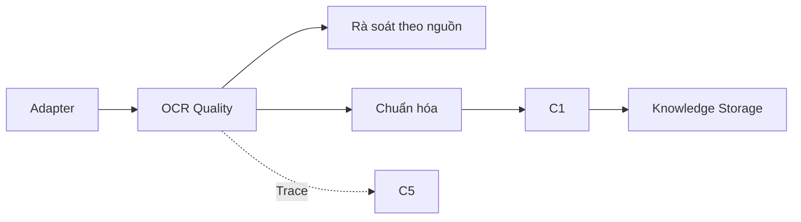
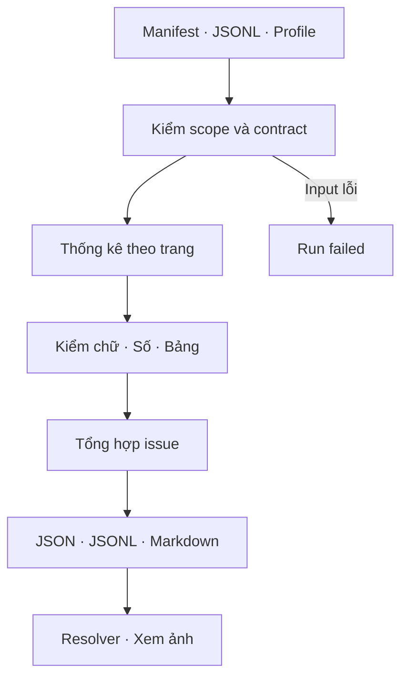

# Kế hoạch — OCRQualityReport

**Trạng thái:** Đã triển khai contract/checks v1 và kiểm thử local; hiệu chỉnh trên Drive và review ảnh còn chờ thực hiện. Các thiết kế tương lai vẫn mang nhãn Đề xuất/TBD.  
**Tài liệu cha:** [Module 1](01-document-ingestion.md) · [Level 0](00-overview.md) · [Quy chuẩn](TECHNICAL_WRITING_STANDARD.md).

## 1. Mục tiêu và trách nhiệm

Đọc kết quả adapter của một báo cáo, phát hiện dấu hiệu OCR cần rà soát và tạo danh sách có thể truy ngược về trang/bảng/ô. Dùng BTS/2025 trước, sau đó thêm hai báo cáo do nhóm chọn: một khác công ty, một khác năm. Người dùng đã xác nhận adapter chạy thành công trên Colab với BTS/2025; kết quả quality trên Drive chưa được đo.

**Đã chốt:** OCR quality tách khỏi kiểm tra kế toán (D05); giữ nguồn và provenance (D04/D08); giữ đủ C1–C5 (D01). Quality report là bước trong Module 1 trước normalization/C1. Nguồn OCR không bị ghi đè; phát hiện lỗi dẫn tới review, còn sửa/re-OCR là thao tác riêng có phiên bản.

**Đề xuất cho lượt triển khai này:** validator xác định bằng Python, chạy CPU, đọc `manifest.json` và `elements.jsonl` đã tạo. Không cần gọi LLM. Mặc định không đọc lại toàn bộ bytes PNG hoặc tính lại hash ảnh; ảnh chỉ mở khi người dùng rà soát issue. Báo cáo ghi rõ tính toàn vẹn nguồn được kế thừa từ lần chạy adapter, không khẳng định vừa kiểm lại ảnh trên Drive.

Kết quả chỉ đánh giá các phép kiểm được khai báo. Mức đúng của chữ/số so với ảnh cần đối chiếu thủ công; kiểm thứ tự đọc và layout đầy đủ còn phụ thuộc dữ liệu thứ tự/ảnh. Không dùng phép cân đối kế toán làm điểm OCR, không chuẩn hóa số/đơn vị và không tạo compliance finding ở bước này.

## 2. Kiến trúc Level 1 và Level 2

### Level 1 — vị trí trong Module 1



Đây là giai đoạn triển khai trong kiến trúc đã chốt. Contract bàn giao cho normalization phải giữ issue và trạng thái theo từng phần tử; điều kiện cho phép dùng dữ liệu đã review thuộc publish policy của Module 1, còn TBD.

### Level 2 — luồng dự kiến



## 3. Workflow và các phép kiểm

1. Nhận thư mục artifact, `access_scope` và quality profile có phiên bản; so khớp scope trước khi đọc nội dung JSONL. Đây là đối chiếu phạm vi trong prototype; xác thực người dùng và ACL thực ở database/retrieval vẫn là dependency của kiến trúc.
2. Kiểm manifest/JSONL đọc được, identity/version/scope của record khớp manifest, refs duy nhất và hợp lệ; tính hash hai artifact làm dấu vết input của quality run.
3. Thống kê theo trang: số block, bảng, ô, số ký tự, ô trống, confidence được cung cấp. Đối chiếu danh sách trang và counts với manifest.
4. Chạy các quy tắc bật trong profile; mỗi quy tắc trả `passed`, `flagged`, `skipped` hoặc `error` và phạm vi đã kiểm. Check thiếu dữ liệu phải ghi lý do skip.
5. Tổng hợp issue, trạng thái và giới hạn đánh giá; xuất kết quả vào một thư mục quality run riêng. Không sửa manifest adapter hay tự nâng trạng thái document.
6. Người dùng mở một số issue qua resolver, đối chiếu ảnh và ghi nhận đúng/sai của cảnh báo; cập nhật quality profile bằng phiên bản mới khi cần.

| Nhóm | Phép kiểm đầu tiên — Đề xuất | Cách diễn giải |
|---|---|---|
| Contract/provenance | Record khác doc/version/scope; ref trùng hoặc không khớp trang/ID; count lệch manifest | Input không đáng tin cho run: `failed`, giữ chẩn đoán; không tiếp tục báo kết quả sạch. |
| Trang | Thống kê lượng chữ/bảng; trang không có OCR; trang ít chữ | Không suy ra trang ít chữ là lỗi: có thể là bìa, chữ ký hoặc biểu đồ. Quy tắc ngưỡng chỉ bật sau khi hiệu chỉnh. |
| Text | Text sai kiểu; ký tự thay thế `U+FFFD`, ký tự điều khiển bất thường; block text rỗng | Sai kiểu là lỗi contract; dấu hiệu nội dung cần review. Không tự sửa text. |
| Ô số nghi vấn | Chuỗi có chữ số và ký tự có thể nhầm trong ứng viên ô số, ví dụ `1O0` | Chỉ gắn cờ khi thỏa mẫu ứng viên trong profile; nhãn dòng/cột cũng có thể chứa chữ và số. Không thay `O` bằng `0`. |
| Bảng/ô | Cell thiếu bảng cha; cell bbox vượt bảng; vị trí row/col lặp | Orphan là lỗi contract; hình học/vị trí lặp cần review vì có thể liên quan ô gộp hoặc cách OCR dựng bảng. |
| Ô trống | Đếm ô trống theo bảng/cột/trang | Ô trống riêng lẻ hợp lệ; không đổi thành 0, không gắn lỗi hàng loạt chỉ vì trống. |
| Confidence | Tỷ lệ text/ô có confidence; kiểu và thang đo nếu đã biết | Thiếu score: `null`/skip. Ngưỡng confidence thấp chỉ bật khi xác định engine, thang đo và profile. |
| Asset tùy chọn | Kế thừa `MISSING_CROP`/`UNMAPPABLE_CROP` của adapter | Giữ mã lỗi và nguồn, không nhân đôi issue. Crop chữ ký/con dấu thiếu không tự làm toàn bộ số liệu tài chính thất bại. |

Adapter hiện dừng bằng `OCRBundleError` khi thiếu cặp JSON/PNG, bbox không hợp lệ hoặc JSON hỏng. Quality report sau adapter không thể tự xem được những bundle bị từ chối đó. Lượt này báo lỗi đầu vào rõ ràng; contract chẩn đoán có cấu trúc cho lần import thất bại là việc nối tiếp, không thay kiểm tra hiện có bằng bỏ qua lỗi.

## 4. Input/output và schema minh họa

| Contract | Producer → consumer | Trường chính |
|---|---|---|
| Bundle artifact | Adapter → validator | Manifest: doc/version/scope, pages, counts, source bundle hash, adapter issues; JSONL: kind, page, text, bbox, source_ref, parent IDs. |
| QualityProfile | Cấu hình được duyệt → validator | `profile_id`, `profile_version`, danh sách check bật/tắt và tham số đã xác định. Ngưỡng chưa xác định phải tắt check hoặc skip có lý do. |
| OCRQualityReport | Validator → người review/normalizer/C5 | Identity, scope, source hash, input artifact hashes, validator/profile versions, run status, quality status, metrics, check coverage, giới hạn và ref danh sách issue. |
| OCRQualityIssue | Check → review/downstream | ID, check/code, severity, review_required, page, source_ref khi có, locator cho lỗi cấp trang/manifest, bằng chứng quan sát và lý do. |

**JSON ví dụ giả lập — không phải kết quả BTS:**

```json
{
  "report_id": "quality-run-example",
  "document_id": "example-report",
  "document_version": "ocr-bundle-v1",
  "access_scope": "demo-scope",
  "source_bundle_sha256": "<SHA-256 từ adapter>",
  "profile": {"profile_id": "legacy-ocr", "profile_version": "1"},
  "execution_status": "completed",
  "quality_status": "needs_review",
  "visual_accuracy": "not_measured",
  "issues_ref": "quality_issues.jsonl"
}
```

**JSON Schema rút gọn, draft 2020-12 — Đề xuất:**

```json
{
  "$schema": "https://json-schema.org/draft/2020-12/schema",
  "type": "object",
  "required": ["check_id", "code", "severity", "review_required", "page", "source_ref", "reason"],
  "properties": {
    "check_id": {"type": "string"},
    "code": {"type": "string"},
    "severity": {"enum": ["info", "warning", "error"]},
    "review_required": {"type": "boolean"},
    "page": {"type": ["integer", "null"], "minimum": 1},
    "source_ref": {"type": ["string", "null"]},
    "reason": {"type": "string"}
  }
}
```

Schema đầy đủ và tên enum phải chốt ở bước đầu triển khai. Issue cấp ô/block dùng ref adapter có thật. Lỗi cấp manifest có `source_ref=null` cùng locator tương đối; không tạo ref tới ô không tồn tại. Không đưa đường dẫn nội bộ `.shortcut-targets-by-id` vào output.

## 5. Lưu trữ và cấu trúc dữ liệu

**Đề xuất layout:** `Financial_MultiAgent_Results/BTS/2025/ocr-bundle-v1/quality/<run-id>/` gồm `quality_report.json` (summary/coverage), `quality_issues.jsonl` (chi tiết) và `quality_report.md` (bản dễ đọc). Artifact adapter ở thư mục cha giữ nguyên.

Prototype chưa cần database mới. Mô hình bảng tương lai: `ocr_quality_run` có PK `report_id`, FK document/version, scope, input hashes, validator/profile versions, status và output refs; `ocr_quality_issue` có PK `(report_id,issue_id)`, FK run, check/code, severity, page/source_ref, evidence. Index theo scope/document/version và source_ref. Module 1 sở hữu; Module 2 tích hợp vào structured DB về sau.

Run và issue kế thừa scope của nguồn. Cùng input/profile/version cho cùng issue ổn định; run mới có ID riêng, không ghi đè kết quả cũ. Đổi nguồn/profile/validator làm run trước không còn là đánh giá hiện hành của input mới; raw cũ vẫn giữ. Cơ chế đánh dấu current và retention: TBD.

## 6. Functions/classes và tools cần xây dựng

Các tên sau là Đề xuất, chưa phải API đã tồn tại:

| Giao diện | Trách nhiệm |
|---|---|
| `OCRQualityValidator.assess(manifest, records, profile)` | Logic xác định; trả metrics/check coverage/issues; không tự mở ảnh hay sửa dữ liệu. |
| `assess_ocr_bundle(bundle_dir, output_dir, access_scope, profile)` | Kiểm contract/scope, hash artifact, điều phối validator và ghi quality run. |
| `QualityProfile` / `OCRQualityReport` / `OCRQualityIssue` | Contract versioned cho cấu hình và kết quả. |
| `write_quality_report(report, issues, output_dir)` | Ghi staging, công bố run hoàn chỉnh; output chưa hoàn tất không được coi là completed. |
| `resolve_source_ref(...)` hiện có | Dùng cho notebook review, mở đúng ảnh khi người dùng chọn issue. |

File đã có: [ocr_quality.py](../financial_multiagent/ingestion/ocr_quality.py), [schema v1](../financial_multiagent/ingestion/ocr_quality.schema.json), [test quality](../tests/module_01/test_ocr_quality.py) và [notebook Colab](../colab/01_ocr_quality_report.ipynb). Profile mặc định nằm trong dataclass `QualityProfile`; không có file cấu hình profile ngoài. `assess` trả `OCRQualityReport`; `assess_ocr_bundle` lưu run và trả summary dict có `output_dir`. Summary dùng object `profile` chứa ID/version/tham số, thay cho hai trường profile phẳng trong ví dụ ban đầu. JSON Schema là tài liệu contract; kiểm runtime dùng logic Python và không cần thư viện jsonschema.

## 7. Lỗi, retry và trạng thái

| Điều kiện | Hành vi đề xuất |
|---|---|
| Scope không khớp | Từ chối trước khi trả nội dung/counters; không tạo report chứa dữ liệu ngoài scope. |
| Artifact hỏng/identity sai | `execution_status=failed`, `quality_status=not_assessed`; các check phụ thuộc chưa chạy ghi rõ. |
| Có issue cần review | Run vẫn `completed`, `quality_status=needs_review`; giữ danh sách nguồn và nguyên nhân. |
| Các check bắt buộc chạy đủ, không có issue yêu cầu review | `quality_status=checks_passed`: chỉ nói các phép kiểm đã khai báo đạt, không đo độ đúng OCR so với ảnh. |
| Không đủ dữ liệu để đánh giá các check bắt buộc | `quality_status=not_assessed`; liệt kê check bị skip và lý do. |
| Drive đọc/ghi lỗi tạm thời | Retry hữu hạn, đề xuất tối đa 3 lần có backoff; ghi attempt; thất bại cuối không công bố run completed. |
| Colab reset giữa chừng | Chạy lại theo báo cáo; staging cũ không được đọc như kết quả hoàn chỉnh. Checkpoint từng trang chỉ bổ sung khi có nhu cầu thực tế. |

Severity và `review_required` là hai trường riêng; warning do mẫu heuristic có thể yêu cầu xem lại, info thiếu crop tùy chọn thường không chặn. Không phát sinh điểm tổng kiểu “OCR đúng 95%”. Manifest adapter vẫn `processing`; quality report không tự quyết định `ready` toàn pipeline.

## 8. Dependencies và quyết định còn mở

- **Đã có:** adapter + manifest/JSONL, resolver local/mounted Drive, mẫu BTS/2025; người dùng đã chạy được trên Colab.
- **Đề xuất:** dùng Python standard library cho lượt đầu; pytest cho test. Không cần GPU hay dịch vụ model cho các check đã nêu.
- **TBD:** thang confidence của từng engine, ngưỡng text thưa, mẫu nhận diện ô số, cách biểu diễn ô gộp/thứ tự đọc, policy review/publish và ACL thực.
- **Giả định cần kiểm chứng:** hai báo cáo bổ sung có cùng contract OCR; nếu khác phải mở rộng adapter có phiên bản, không ép dữ liệu vào cấu trúc BTS.
- C5 nhận trace stage/run/check/error; cơ chế nhận event chính thức chưa xây nên lưu trace trong quality run trước. Các module normalization/C1/C2/C3/C4 giữ nguyên phạm vi kiến trúc.

## 9. Acceptance criteria và test dự kiến

| Test | Dữ liệu và điều kiện đạt |
|---|---|
| Q01 — integration | BTS/2025: bao phủ toàn bộ record đã import, thống kê khớp manifest; mỗi issue có phạm vi nguồn, không yêu cầu số lượng issue bằng 0. |
| Q02 — unit | Fixture chữ `U+FFFD`, text sai kiểu, ứng viên số `1O0`: đúng mã lỗi hoặc review, raw không đổi. |
| Q03 — unit | Ô rỗng, dấu `-`, mã chỉ tiêu, ngày, nhãn chữ+số: không tự coi là 0 hoặc đồng loạt báo lỗi số. |
| Q04 — unit | Thiếu confidence: báo coverage và skip có lý do; không tự gán confidence hoặc làm thất bại toàn báo cáo. |
| Q05 — unit | Orphan cell, cell vượt bảng, vị trí lặp: phân biệt lỗi contract với dấu hiệu layout cần review. |
| Q06 — security | Sai scope/doc/version, ref trùng, artifact hỏng: từ chối hoặc failed/not_assessed; không xuất dữ liệu như run thành công. |
| Q07 — integration | Cùng artifact/profile cho cùng issue/metrics; run tách biệt; source và adapter output không thay đổi. Profile/nguồn đổi được nhận diện bằng version/hash. |
| Q08 — integration | Drive shortcut và thiếu crop tùy chọn: refs vẫn dưới đường dẫn logic, ảnh trang mở được, không chặn hàng loạt vì crop tùy chọn. |
| Q09 — recovery | Giả lập lỗi đọc/ghi hoặc dừng trước publish: retry hữu hạn và không có run completed bị thiếu output. |
| Q10 — manual evaluation | Lập bộ đối chiếu đề xuất 30–50 ô và 5–10 block từ vài trang/bảng khác nhau; lưu lựa chọn mẫu trước khi review. Gồm cả mục bị gắn cờ và không gắn cờ để quan sát cảnh báo sai và lỗi bỏ sót; không tuyên bố accuracy toàn tài liệu từ mẫu nhỏ. |

**Kiểm thử local đã thực hiện:** toàn bộ `tests/module_01` đạt **41 passed, 2 skipped**. Hai skip thuộc adapter: Windows không cho tạo symlink, và ảnh PNG BTS không còn ở đường dẫn nguồn cũ. Test quality BTS dùng bản sao artifact manifest/JSONL đã nhập; test notebook compile các ô Python và thực thi các ô report/list issue bằng fixture local. Chưa chạy mount/Git/Drive của notebook trong Colab thay người dùng.

**Lần chạy local trên artifact BTS/2025 hiện có:** 37 trang; 1.046 text block, 36 bảng, 1.410 ô, 109 visual elements; `execution_status=completed`, `quality_status=needs_review`. Có 111 `CELL_OUTSIDE_TABLE` cần xem ảnh và 69 `MISSING_CROP` mức info kế thừa adapter. Confidence text/ô không có. Đây là số cảnh báo tự động trên artifact local, không phải số lỗi OCR đã được xác nhận hoặc kết quả Drive hiện tại.

Các số lượng mẫu review Q10 là đề xuất khối lượng công việc, không phải ngưỡng chất lượng. Q10, lần chạy trên Colab Drive và hai báo cáo bổ sung chưa thực hiện. Không sửa profile chỉ để BTS không còn cảnh báo; kiểm thêm hai báo cáo trước khi chốt ngưỡng.

## 10. Implementation checklist và thứ tự thực hiện

- [x] Hiện thực schema report/issue v1, enum trạng thái và profile đầu tiên; ngưỡng confidence/text thưa mặc định tắt.
- [x] Viết validator và statistics trên manifest/JSONL; xử lý contract/scope trước nội dung.
- [x] Bổ sung report writer versioned và trace; test lỗi không xuất kết quả completed giả.
- [x] Viết test tự động cho các điều kiện Q02–Q09 có thể mô phỏng local; Q01 chạy trên artifact BTS đã nhập. Xác nhận Drive shortcut thực tế tiếp tục ở Colab.
- [ ] Chạy BTS/2025 trên Colab, lưu quality run vào Drive; thực hiện review Q10 và ghi nhận cảnh báo đúng/sai.
- [ ] Chạy hai báo cáo bổ sung, hiệu chỉnh profile có phiên bản và ghi các biến thể OCR cần adapter hỗ trợ.
- [ ] Cập nhật trạng thái/test thật trong Module 1, commit theo thành phần và push để Colab lấy code.
- [ ] Chốt contract bàn giao issue/fact review trước khi triển khai FinancialNormalizer; tiếp tục C1–C5 theo kiến trúc đã thống nhất.

**Kết quả bàn giao của bước này:** một lệnh/hàm chạy trên Colab cho một báo cáo, ba artifact quality trong Drive, danh sách issue mở lại được theo nguồn và bộ test tương ứng. Chưa chạy toàn bộ kho báo cáo.
