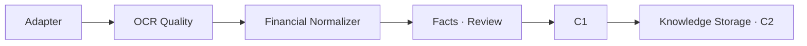
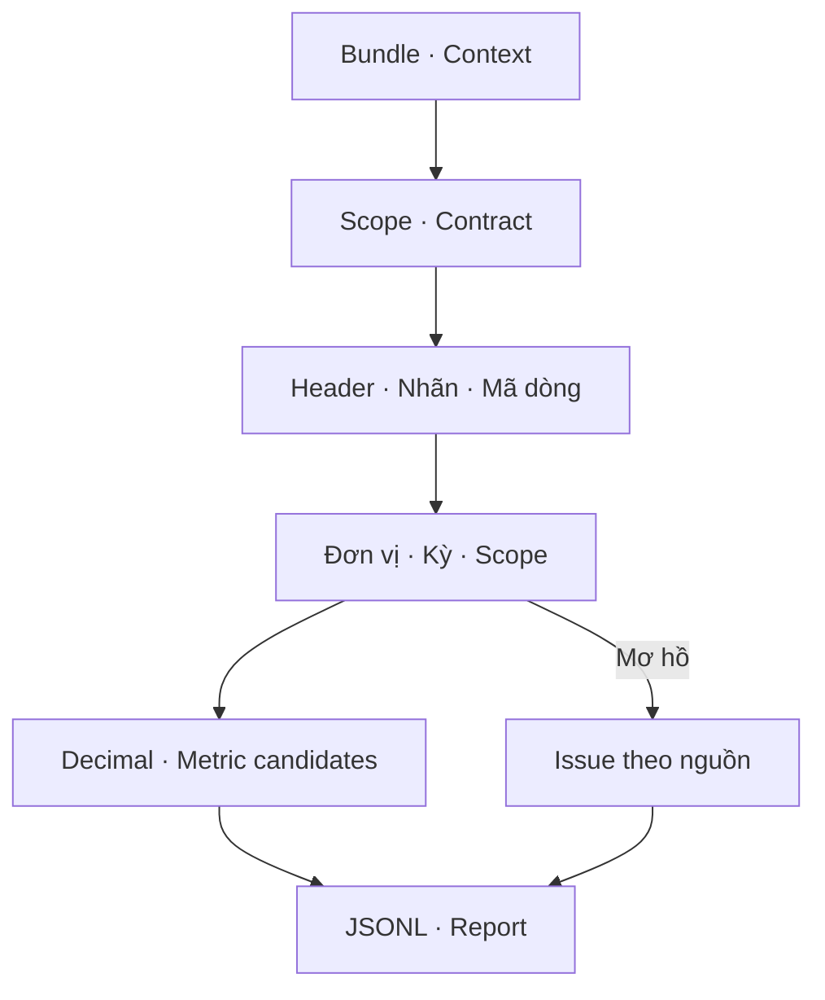

# Financial Normalization — lát cắt bảng kết quả kinh doanh

**Trạng thái:** đã có code và kiểm thử local cho một bảng được chọn; chưa chạy notebook này trên Drive thay người dùng.
**Cha:** [Module 1](01-document-ingestion.md) · [Level 0](00-overview.md) · [OCR Quality](01a-ocr-quality-report-plan.md) · [Quy chuẩn](TECHNICAL_WRITING_STANDARD.md).

## 1. Mục tiêu và trách nhiệm

Nhận bundle OCR đã nhập, chọn rõ một trang/bảng, đọc ngữ cảnh và tạo `FinancialFact` candidates với số thập phân chính xác và nguồn ô. **Đã chốt — D05/D06/D08:** giữ raw, đơn vị/kỳ/scope và provenance; chất lượng OCR, chuẩn hóa và kiểm toán kế toán là các bước riêng.

**Giai đoạn triển khai hiện tại:** bảng kết quả hoạt động kinh doanh có tên rõ, một header gồm `CHỈ TIÊU`, `Mã số`, `Năm nay`, `Năm trước`. Vị trí cột được đọc từ header, không cố định theo BTS. Thử trước `BTS/2025`, trang 12, `table_001`. Các layout khác báo lỗi rõ ràng để bổ sung adapter/profile về sau. Toàn bộ phạm vi normalization D06, C1–C5 vẫn là kiến trúc mục tiêu.

**Đề xuất được hiện thực v1:** ontology nội bộ `b02dn-draft-1` dùng mã dòng và nhãn corroboration, hỗ trợ nhóm doanh thu, chi phí, lợi nhuận, thuế và EPS. Đây chưa phải ontology đã thẩm định hay crosswalk VAS/IFRS. Chưa hỗ trợ bảng cân đối, lưu chuyển tiền tệ, note nhiều cấp, quý, restatement resolution hoặc chuẩn hóa toàn bộ báo cáo.

## 2. Kiến trúc Level 1 và Level 2





`normalized_candidate` ở sơ đồ là kết quả biến đổi có ngữ cảnh, chưa phải claim đã qua C4 hay document `ready`.

## 3. Workflow theo từng bước

1. Đọc manifest và so khớp scope trước khi đọc JSONL; kiểm toàn bộ contract bằng `OCRQualityValidator`. Sai scope bị từ chối, sai contract dừng trước output.
2. Chọn đúng trang/table ID, kiểm tên bảng và một header được hỗ trợ. Header mơ hồ, nhiều ô cùng row/col hoặc layout khác dừng để review.
3. Lấy nhãn, mã dòng và hai ô giá trị từng dòng. Cả mã lẫn nhãn phải khớp mapping; không dùng riêng mã số để gán chỉ tiêu. Cột thuyết minh/mã số không biến thành monetary fact.
4. Đọc text block cùng trang, phía trên bảng: đơn vị, dòng `Cho năm tài chính kết thúc ngày ...`, scope khi title có `hợp nhất`/`riêng`. Không dùng tên folder hoặc `report_year` để đoán kỳ hay scope. Nhiều khai báo mâu thuẫn dẫn tới review.
5. Nhận metadata được caller xác nhận qua `NormalizationContext` và ghi chú nguồn. Company binding là cấu hình người chạy, chưa phải registry pháp nhân. Metadata khác với khai báo rõ trong trang không âm thầm thay nguồn.
6. Parse theo locale chỉ định: mặc định `vi_VN` dùng dấu chấm nhóm nghìn, dấu phẩy thập phân; ngoặc là âm. Hỗ trợ `en_US` khi caller chọn rõ. Số không hợp lệ giữ raw và issue; không sửa `O` thành `0`. Placeholder trống/gạch/`_` không thành 0.
7. Nhân đơn vị tiền bằng `Decimal`; chuẩn đầu ra là VND. EPS cần xác nhận `VND/share` riêng, không dùng hệ số triệu/nghìn của bảng. Ngày đầu kỳ chưa có thì null, không tự gán 1/1. `Năm trước` lấy ngày cuối kỳ lùi một năm từ ngữ cảnh năm nay; nếu ngày đó không hợp lệ thì review.
8. Giữ issue OCR liên quan đến ô, nhãn, header và ngữ cảnh. Nhận xét người dùng rằng nội dung cơ bản ổn không được dùng làm phê duyệt hàng loạt các ô chưa đối chiếu. Hint điều chỉnh/hồi tố làm fact cần review.
9. Ghi ba artifact vào run riêng; upstream nguyên trạng. Kỳ/scope/đơn vị thiếu hoặc xung đột, metric chưa map hay có OCR issue đều được lưu trong `normalization_issues`.

## 4. Input/output và schemas

| Contract | Producer → consumer | Nội dung |
|---|---|---|
| Manifest/JSONL | Adapter → normalizer | Identity/version/scope, page/table/cell records, text/bbox/refs; hash input được ghi vào summary. |
| NormalizationContext | Notebook/config → normalizer | Company binding, scope và evidence note, period overrides theo cột, unit/EPS override, accounting basis, locale. Metadata được điền phải có ghi chú nguồn. |
| FinancialFact candidate | Normalizer → review/downstream | Raw và parsed/value, metric draft, kỳ/scope, context refs, issue OCR, trạng thái. |
| Normalization report | Runner → người dùng/C5 | Phiên bản thuật toán/ontology/quality validator, input/context hashes, counts, giới hạn và refs output. |

Ví dụ rút gọn từ kết quả local BTS trang 12:

```json
{
  "metric_code": "revenue_net",
  "statement_code": "10",
  "raw_value": "2.656.580.390.998",
  "parsed_value": "2656580390998",
  "value": "2656580390998",
  "raw_unit": "VND",
  "unit": "VND",
  "period_end": "2025-12-31",
  "period_start": null,
  "consolidation_scope": null,
  "source_ref": "BTS-2025-report/ocr-bundle-bts-2025-v1/p12/table_001/table_001_cell_019",
  "quality_state": "needs_review",
  "normalization_issues": ["INCOMPLETE_PERIOD", "UNKNOWN_SCOPE"]
}
```

Contract đầy đủ: [financial_fact.schema.json](../financial_multiagent/ingestion/financial_fact.schema.json), draft 2020-12, contract candidate v1. `value` là chuỗi ở **đơn vị cơ sở**, khác ví dụ tổng quát Module 1 dùng số gắn `million_VND`: ở đây `raw_unit`/`unit_multiplier` giữ đơn vị nguồn và `unit` giữ VND hoặc VND/share. Các trường thiếu của candidate được phép null, khác schema published rút gọn trong tài liệu cha. Chưa quyết định contract published cuối cùng.

`normalized_candidate` cần đủ company, metric, giá trị, đơn vị, start/end, scope và không còn issue được phát hiện. `accounting_basis=null` vẫn thể hiện rõ chưa có basis; thuật toán không thực hiện mapping VAS/IFRS. `restatement_status=not_assessed` không khẳng định không có restatement. Accounting validation và C4 tiếp tục cần thiết trước sử dụng làm kết luận.

## 5. Database tables và cấu trúc dữ liệu

Chưa thêm DB. Output trong `Financial_MultiAgent_Results/<ticker>/<year>/<bundle>/normalization/<run-id>/` gồm `financial_facts.jsonl`, `normalization_issues.jsonl`, `normalization_report.json`. Fact ID phụ thuộc source_ref, source hash, record, metadata context và phiên bản thuật toán/ontology; chạy lại cùng input cho cùng ID, run ID riêng.

Đích tương lai là bảng `financial_fact` thuộc Module 1 bàn giao Module 2 như tài liệu cha: index scope/company/period/metric và FK document/version/source. Candidate null/review cần collection hoặc trạng thái riêng, không ghi thành published fact đủ chuẩn. Khi đổi nguồn/context/ontology, tạo run mới; current selection, invalidation và retention còn TBD.

## 6. Functions/classes/APIs và tools

| Giao diện đã có | Hành vi |
|---|---|
| `parse_financial_number(raw, locale)` | Trả decimal string hoặc null cho placeholder; số sai phát `NormalizationError`; không sửa raw. |
| `NormalizationContext(...)` | Metadata và evidence note; kiểm ngày, scope, locale và các override hợp lệ. |
| `FinancialNormalizer.normalize(manifest, records, page, table_id, context)` | Hàm logic trên artifact: kiểm contract, layout, context, tạo facts/issues; không đọc ảnh. |
| `normalize_financial_table(bundle_dir, page, table_id, access_scope, context, output_dir)` | Runner đọc input, tạo summary hashes, ghi staging và publish run. |
| `resolve_source_ref(...)` | API hiện có để notebook mở lại đúng ô/ảnh và những context_refs cần đối chiếu. |

Code ở [financial_normalization.py](../financial_multiagent/ingestion/financial_normalization.py); [notebook 02](../colab/02_financial_normalization.ipynb) cấu hình và chạy một bảng trên Drive. C1, rule extraction và agent APIs chưa được triển khai trong bước này.

## 7. Lỗi, retry và trạng thái

| Điều kiện | Hành vi |
|---|---|
| Sai scope trước đọc record, hoặc record khác scope | PermissionError, không publish run chứa dữ liệu đó. Scope đối chiếu chưa thay thế ACL thực. |
| Input hỏng, sai identity/refs hoặc layout chưa hỗ trợ | Dừng bằng lỗi; upstream giữ nguyên; không ghi completed giả. |
| Một giá trị sai, thiếu đơn vị/kỳ/scope, metric xung đột | Candidate `needs_review`, raw và lý do còn đủ; phần có thể parse vẫn lưu. |
| Thiếu ô value trong dòng | Issue có table ref và row/col; không tạo ref ô giả hoặc suy ra 0. |
| Đủ thông tin cho các kiểm tra v1 | `normalized_candidate`; không tự sửa manifest document, không publish vào knowledge storage. |
| Ghi/đọc storage lỗi hoặc Colab reset | Lượt này không tự retry I/O; caller chạy lại sau khôi phục. Mỗi run ghi staging rồi rename thư mục hoàn chỉnh; test gián đoạn ghi không tạo run cuối. |

Retry/backoff và checkpoint theo trang cho toàn bộ normalizer còn TBD. Runner hiện phù hợp lát cắt một bảng; không giả định đã đạt cơ chế phục hồi toàn kho. Reprocess tạo run/version trace mới, không ghi đè kết quả cũ.

## 8. Dependencies

- **Đã có:** adapter bundle; OCRQualityValidator; Python standard library, Decimal; resolver cho nguồn local/mounted Drive. Không cần GPU/model cho lát cắt này.
- **Đã chốt:** quyền theo source và provenance D04/D08/D09; context phải theo công ty/kỳ, không trộn nhiều báo cáo.
- **Đề xuất hiện thực:** ontology B02 nội bộ, chỉ mapping mã và nhãn phù hợp; lưu file trước khi tích hợp DB/C2.
- **TBD:** ontology tài chính được duyệt, VAS/IFRS/restatement mapping đầy đủ, calendar doanh nghiệp, nhiều loại báo cáo, basis registry, ACL thực và cổng publish `ready`.

## 9. Acceptance criteria và test cases

| Nhóm test | Tiêu chí |
|---|---|
| Locale/Decimal | Nhóm nghìn/thập phân, số âm, số rất lớn và nhân hệ số chính xác; chuỗi OCR sai không được tự sửa. |
| Missing | `_`, gạch, ô trống thành missing; số 0 thật vẫn 0. |
| Unit/dimension | Triệu/nghìn về VND; EPS không được nhân theo đơn vị tiền của bảng; unit mơ hồ/xung đột giữ review. |
| Kỳ/scope/company | Không lấy từ folder; metadata thiếu/null rõ; khai báo xung đột không bị override; evidence note bắt buộc. |
| Mapping/layout | Mã dòng cần nhãn khớp; unknown giữ candidate review; cột code/note không thành facts; layout khác dừng. |
| Provenance/security | Scope trước nội dung; raw và bundle không đổi; fact/ref/version/hash truy được về nguồn; giữ issue OCR liên quan. |
| Run/storage | IDs ổn định cùng input, output riêng; lỗi ghi không publish run một phần. |
| BTS local | 36 candidates, 34 số parse được, 32 giá trị tiền chuẩn hóa; gross/net/âm đúng; hai `_` và hai EPS chưa xác nhận giữ missing/review thích hợp. |
| Notebook | Compile code cells, thực thi ô normalization/list facts bằng fixture local. Mount/Drive thật chờ người dùng chạy Colab. |

Toàn bộ `tests/module_01` đạt **85 passed, 2 skipped**. Hai skip là test adapter cần symlink Windows và ảnh BTS ở đường dẫn cũ; test normalization BTS dùng artifact đã nhập và đã chạy. Số liệu BTS trên đây đo từ artifact local, không chứng minh nội dung đúng với ảnh. Kiểm thêm hai báo cáo và manual review vẫn chưa hoàn tất.

## 10. Implementation checklist

- [x] Parse số chính xác, unit scaling và placeholder policy.
- [x] Mapping draft có corroboration label/code; header roles và provenance context.
- [x] Nullable candidates/review reasons, schema riêng và versioned writer.
- [x] Fixture tests và integration trên artifact BTS local.
- [x] Notebook mới trong colab/; notebook quality người dùng đã chạy giữ nguyên.
- [ ] Người dùng chạy notebook normalization trên Drive và đối chiếu vài facts/metadata.
- [ ] Xác nhận calendar/scope/EPS unit từ nguồn, chạy lại với metadata có evidence.
- [ ] Thử thêm báo cáo khác công ty/năm và bổ sung layout có phiên bản.
- [ ] Mở rộng các báo cáo/basis/restatement theo D06; tiếp tục financial consistency, regulation/C1 rồi C2–C5 theo kiến trúc đã thống nhất.
