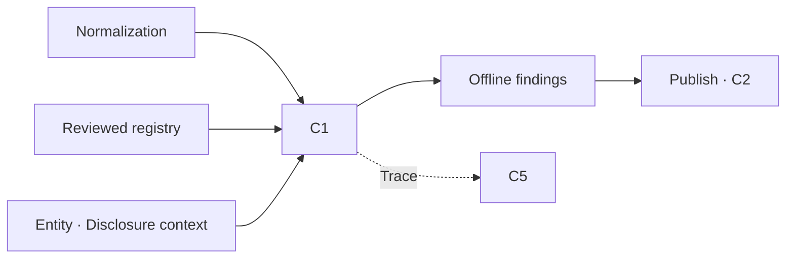
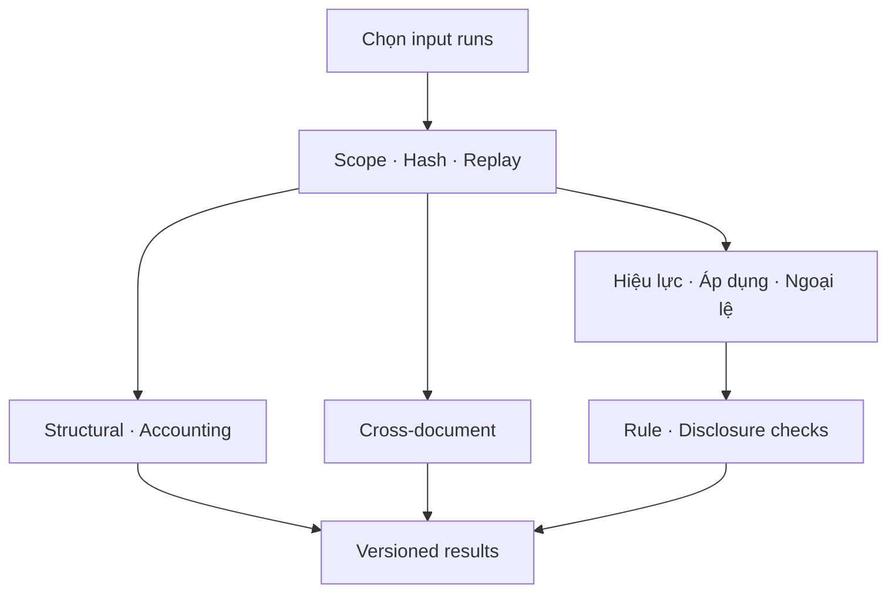

# C1 — Contextual validation

**Trạng thái:** có engine, runner, schemas, notebook và test local; nguồn quy định production và notebook Drive thực tế chưa được xác nhận. [Cha: Module 1](01-document-ingestion.md) · [Level 0](00-overview.md) · [Cấu trúc repo](07-repository-structure.md).

## 1. Mục tiêu và trách nhiệm

**Đã chốt D01/D05/D08/D10/D13:** C1 giữ structural validation, accounting consistency, disclosure compliance, cross-document consistency, violation detection và dual provenance. Chạy offline sau normalization, trước publish Knowledge Storage; C4 kiểm claim runtime về sau.

**Đã hiện thực v1:** engine xác định bằng Python/Decimal, cấu hình phép kế toán có phiên bản, curated rule registry, applicability/exception/effective-date evaluation và source catalogs. Không có luật pháp thực tế được nhúng sẵn. Rule extraction tự động là upstream còn chưa triển khai; C1 nhận registry đã được rà soát qua contract thay vì suy diễn nội dung luật.

**Phạm vi đánh giá:** chỉ facts/rules/observations được truyền vào. Báo cáo thiếu quy định hoặc metadata cần thiết vẫn chạy hoàn tất nhưng outcome liên quan là unknown. Sai lệch tài chính không tự thành violation. Không thay đổi C1–C5 hoặc cổng `ready`.

## 2. Kiến trúc Level 1 và Level 2





## 3. Workflow

1. Caller chọn rõ một hay nhiều `C1Input(bundle_dir, normalization_dir)` và scope. Kiểm scope normalization summary và adapter manifest trước đọc records/facts.
2. So khớp identity/source hash/input hashes, phiên bản normalizer/ontology/quality validator. Khôi phục context từ normalization report và kiểm context hash.
3. Replay deterministic normalizer trên snapshot JSON. Facts đã lưu phải khớp toàn bộ kết quả replay; sửa riêng value hoặc quality_state không được chấp nhận. Không đọc lại bytes PNG ở bước này. Direct pure-engine callers phải cung cấp catalog tin cậy; production orchestration dùng runner để có replay gate.
4. Structural check ghi completeness theo document/version. Sai source/duplicate fact/scope là input error; missing metadata hoặc review trở thành unknown.
5. Accounting: nhóm riêng theo doc/version/company/start/end/scope/unit/ontology/basis/period kind; không ghép các nhóm để hoàn thành công thức. Missing/duplicate metric hoặc fact chưa đủ tin cậy trả unknown. Phép tính đủ điều kiện trả pass hoặc warning theo residual/tolerance.
6. Cross-document: chỉ so cùng công ty, kỳ, scope, unit, ontology, basis, metric và period kind giữa tài liệu khác nhau; basis chưa rõ hoặc version/fact mơ hồ trả unknown. Tài liệu không so được có coverage unknown.
7. Rule evaluation: kiểm nguồn điều khoản/hash/review, điều kiện đối tượng, hiệu lực cho toàn kỳ và exceptions. Hiệu lực chỉ giao một phần kỳ trả unknown (chưa có temporal split). `effective_to=null` chỉ vô hạn khi `open_ended=true` rõ ràng. Hai version cùng rule ID áp dụng trùng kỳ trả unknown.
8. Predicate v1: `metric_comparison` so metric chuẩn với threshold/đơn vị được định nghĩa trong rule; `required_disclosure` dùng observation đã review. Thiếu fact không chứng minh thiếu công bố.
9. Ghi report/results và snapshot registry/context trong run bất biến. Mỗi result giữ fact IDs, financial refs, legal refs, rule version, applicability, reason và trace details. Không ghi claim runtime hay verified ledger.

## 4. Input/output và schemas

| Contract | Producer → C1 | Ràng buộc |
|---|---|---|
| Normalization run | FinancialNormalizer → runner | Summary + financial_facts JSONL; scope/version/hashes và replay phải khớp. |
| Financial source catalog | Adapter snapshot → engine | Mỗi fact ref resolve tới record đúng doc/version/scope và raw text. |
| Rule registry | Nhóm rà soát/registry tương lai → engine | Sources có text lưu, hash UTF-8, URI nguồn, document/version/article/ref/review; rules có ID/version/predicate/effective dates/applicability/exceptions. |
| C1 context | Cấu hình được xác nhận → engine | Entity attributes chỉ thêm entity_type/industry; không override kỳ/scope của facts. Disclosure observations có document/company/kỳ/scope, refs, coverage/reviewer/note. |
| C1ValidationResult | Engine → report/future C2 | category, outcome, fact IDs, nguồn, rule version, applicability, reason/details, `verification_stage=offline_c1`. |

Schemas v1: [result](../financial_multiagent/validation/c1/schemas/result.schema.json), [registry](../financial_multiagent/validation/c1/schemas/registry.schema.json), [context](../financial_multiagent/validation/c1/schemas/context.schema.json), draft 2020-12. Các schema là contract/documentation, engine thực thi runtime checks, không cần thư viện jsonschema.

Ví dụ rút gọn cho nguồn chưa đủ:

```json
{
  "category": "regulatory",
  "name": "rule_coverage",
  "outcome": "unknown",
  "reason": "NO_REVIEWED_RULE_REGISTRY",
  "fact_ids": [],
  "financial_source_refs": [],
  "legal_source_refs": [],
  "rule_id": null,
  "rule_version": null,
  "applicability": null,
  "verification_stage": "offline_c1"
}
```

**Quyết định triển khai v1:** outcome gồm pass/warning/unknown/not_applicable/violation. `not_applicable` là mở rộng tường minh của schema rút gọn đề xuất trong tài liệu cha; không coi rule hết hiệu lực là pass. Violation chỉ thuộc regulatory/disclosure, rule đã áp dụng và cả hai nguồn được resolve trong catalog có quyền. Source text được review theo registry do nhóm cấp; hash không tự chứng minh văn bản đó là luật chính thức. Xác thực pháp lý và review registry là trách nhiệm upstream.

Accounting facts cần đủ company, unit, scope và thời điểm; duration cần start/end, instant cần end. `quality_state=normalized_candidate` hoặc `accepted` và không còn issue chặn. Nếu còn metadata/review nhưng đủ số cùng nhóm, `details.numeric_diagnostic` có thể ghi actual/expected/residual với `trusted_for_validation=false`; outcome vẫn unknown, không dùng làm claim đã xác minh.

## 5. Lưu trữ và dữ liệu

Run ở `<bundle>/c1/<run-id>/` gồm `c1_report.json`, `validation_results.jsonl`, `c1_report.md`, `registry.snapshot.json`, `context.snapshot.json`. Report lưu input normalization IDs/hashes, nguồn bundle hash, rule/context hashes, profile/algorithm/accounting definition hashes. Không tự chọn latest ở runner.

Tương lai bảng `c1_validation_result`: PK check_id + run_id; document/fact/rule version, category/outcome/applicability, refs và scope; index scope/document/period/rule/outcome. C1 sở hữu kết quả offline; C2 nhận evidence/findings có version, C4 ledger riêng. Chưa có DB hay publish ack trong lượt này. Đổi context/source/rules cần run mới; current-run registry/invalidation/retention còn TBD.

## 6. Functions/classes/APIs

| Code | Trách nhiệm |
|---|---|
| `contracts.C1Profile` / `make_result` | Version/tolerance và invariants; violation cần hai nguồn và applicable rule. |
| `FinancialConsistencyValidator.check` | Phép kế toán cấu hình; Decimal exact, không eval và không zero mặc định. |
| `cross_document_checks` | So nhóm dữ kiện tương đương có basis, không trộn tài liệu/kỳ. |
| `regulatory.applicability` | Effective window, membership conditions, exceptions; unknown khi thiếu dữ liệu. |
| `regulatory_checks` | Predicate numeric/disclosure và provenance policy. |
| `C1Validator.validate` | Pure orchestration sáu nhóm chức năng và coverage. |
| `runner.load_input` / `run_c1` | Scope/hash/replay, snapshot, atomic directory publication. |
| `python -m financial_multiagent.validation.c1` | CLI một input; API nhận danh sách input để đối chiếu nhiều tài liệu. |

Accounting profile đóng gói tại [accounting_checks.json](../financial_multiagent/validation/c1/profiles/accounting_checks.json), gồm identities kết quả kinh doanh, balance và cash bridge. Normalizer hiện mới sinh bảng kết quả kinh doanh; tests balance/cash dùng facts tổng hợp. Định nghĩa công thức là kiểm tra kế toán có cấu hình, không phải điều khoản pháp luật. Công thức thuế gồm current và deferred, thiếu một term trả unknown; chưa tự chọn biến thể công thức in trên báo cáo.

## 7. Trạng thái, lỗi và retry

| Điều kiện | Hành vi |
|---|---|
| Scope sai | PermissionError trước khi công bố nội dung; không publish report của nguồn ngoài scope. |
| Hash/source/replay/schema input không khớp | C1InputError hoặc input parse error; không tạo completed run giả, upstream không đổi. |
| Dữ kiện thiếu/review | Check unknown; numeric diagnostic chỉ là số hỗ trợ rà soát. |
| Kế toán lệch | Warning với residual, source refs, công thức/tolerance; không tự tạo violation. |
| Rule thiếu/mơ hồ/ngoại lệ chưa rõ | Unknown hoặc not_applicable với lý do rõ. |
| Công bố được kết luận absent | Cần observation accepted, reviewer/note, complete_reviewed coverage và finance refs; partial/không có observation trả unknown. |
| Ghi Drive lỗi/reset | Không tự retry I/O trong runner v1; caller chạy lại sau khôi phục. Staging không được xem là final. Retry hữu hạn/queue/resume toàn kho còn TBD. |

`execution_status=completed` không đồng nghĩa báo cáo hợp lệ pháp lý. `legal_status=unknown` khi còn phần regulatory/disclosure không đủ dữ liệu. `evaluated_supplied_rules` chỉ nói registry được truyền đã được đánh giá, không chứng nhận tuân thủ toàn bộ pháp luật. C1 không nâng `ready` và không cấp C4 ACCEPT.

## 8. Dependencies

- **Đã có:** ingestion artifacts, normalization replay v1, Decimal, scoped JSON utility và versioned writer, notebook 03.
- **Đề xuất hiện thực:** curated registry và manual disclosure observations trước khi có extractor/registry backend; default rỗng trong configs. Rule synthetic bị tắt trừ profile test explicit.
- **TBD/chưa có:** tập quy định production đã rà soát, automatic regulation extraction, temporal split, rule conflict resolution nâng cao, ontology/basis crosswalk, completeness inventory tự động, ACL thực/database, publish/C2/C4 và C5 benchmarks.
- Không suy ra ngành, loại doanh nghiệp, scope hoặc ngày đầu kỳ từ ticker/folder; context do nguồn hoặc người dùng xác nhận phải đi cùng trace.

## 9. Acceptance criteria và tests

- Accounting khớp/lệch dùng số chính xác; metadata/unit/kỳ/scope khác không ghép lại; placeholder hoặc metric thiếu không coi 0; duplicate metric unknown.
- Rule outside effective period, mid-period change, missing date, exemption, missing entity attribute, pending review và overlapping versions không tạo violation sai.
- Violation synthetic trong unit test có rule version và dual provenance; default production profile không chạy luật tổng hợp.
- Disclosure absent chỉ tạo violation trên inventory được review đầy đủ, đúng tài liệu/company/kỳ/scope và finance refs có thật.
- Runner replay phát hiện sửa facts/context, source snapshot cũ, duplicate input; sai scope bị chặn trước nội dung; lỗi ghi không publish run một phần.
- Notebook compile code cells và thực thi stage/view bằng fixture; Drive mount/Git/review production do người dùng chạy.

**Kết quả local:** `python -m pytest -q` đạt **148 passed, 2 skipped**, gồm 63 ca C1. Hai skip thuộc adapter cũ do quyền symlink Windows và thiếu ảnh BTS ở đường dẫn cũ. Wheel đã build được và kiểm tra đọc được 8 accounting definitions cùng 3 C1 schemas từ package đóng gói.

**BTS snapshot hiện có:** execution completed, 18 checks unknown do context/coverage/rules chưa đủ; không có pass hoặc violation. Có 10 chẩn đoán số học với residual bằng 0, vẫn `trusted_for_validation=false`. Đây là chạy local trên normalization snapshot hiện có, chưa là lần chạy C1 trên Drive của người dùng. Bộ luật test hoàn toàn giả lập, không là bộ quy định dùng cho demo công khai hay đánh giá compliance thực tế.

## 10. Implementation checklist

- [x] Ranh giới package C1, shared artifacts, schema/profile versioned và CLI.
- [x] Sáu thành phần chức năng C1 với unknown/coverage khi thiếu input.
- [x] Replay, scope/version/hash/provenance và kết quả bất biến.
- [x] Unit/integration tests cho math, applicability, absence proof, failures và notebook.
- [x] Notebook C1 mới; giữ nguyên notebook 01/02 người dùng đang làm việc.
- [ ] Người dùng chạy notebook 03 trên Drive; xác nhận metadata khi cần kiểm tra có kết luận.
- [ ] Cấp văn bản/rules production được rà soát; triển khai extractor và rule registry backend.
- [ ] Bổ sung các báo cáo, calendar, ontology/basis/restatement và coverage inventory.
- [ ] Publish/ACL thực/C2 rồi Online C3–C4 và C5 theo kiến trúc đã thống nhất.
