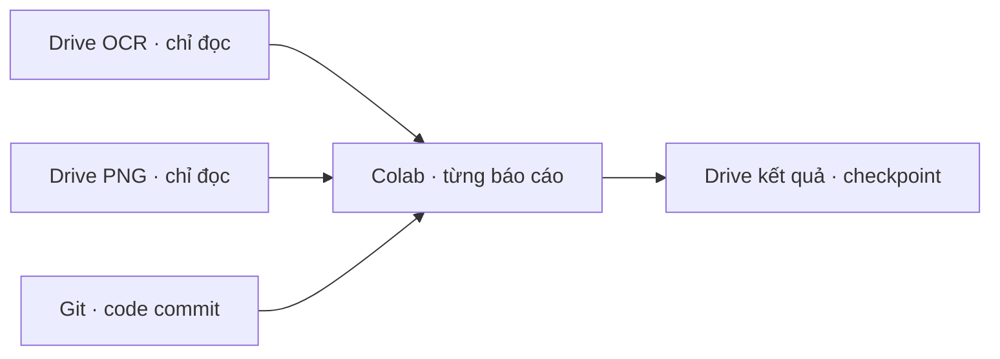

# Module 1 — chạy pilot Drive · Git · Colab

**Trạng thái:** đã chạy pilot trên Colab cho BTS, BTW, BPC, mỗi mã từ 2021 đến 2025, với commit `4dd48a5`. Cả 15 báo cáo có checkpoint trên [Drive 3](https://drive.google.com/drive/folders/15NHeju4YoIftMayvZYl1DAJVE5iKER5H). Đây là cách triển khai nhánh dữ liệu OCR có sẵn, không thay phạm vi kiến trúc Module 1/C1–C5. Xem [Level 0](00-overview.md), [Module 1](01-document-ingestion.md), [C1](01c-c1-validation.md) và [bàn giao Drive](09-drive-colab-handoff.md).

## Level 0 — luồng và mục đích

Pilot chỉ chọn **BTS, BTW, BPC**. `Financial_Report_OCR` cung cấp JSON OCR; `Financial_Report` cung cấp PNG trang. Hai thư mục nguồn chỉ đọc. Notebook trên Colab lấy code bằng Git, dùng Drive API truy cập file theo ID, tải từng báo cáo vào thư mục tạm của runtime, chạy adapter → OCR quality → normalization bảng kết quả kinh doanh được hỗ trợ → C1, rồi upload artifact vào `multi_agent_financial/module_01_pilot/`. Thư mục tạm được xóa sau mỗi báo cáo. Không tải toàn bộ dataset về máy local.

## Level 1 — đầu vào, đầu ra và resume

**Đầu vào:** ID ba thư mục Drive trong [link_drive.txt](link_drive.txt), quyền Google của runtime Colab, commit Git, `access_scope`, tập mã và năm được chọn. Notebook [00_module1_drive_pilot.ipynb](../colab/00_module1_drive_pilot.ipynb) mặc định chạy mọi năm có trong ba mã pilot; có thể đặt `YEARS = ('2025',)` để thử một năm. Runner từ chối mã ngoài BTS/BTW/BPC. Chạy full các mã khác là công việc riêng theo yêu cầu sau của người dùng.

**Đầu ra mỗi báo cáo:** `manifest.json`, `elements.jsonl`, `drive_source_map.json`, quality report/issues, normalization runs của bảng được hỗ trợ, C1 runs tương ứng và `pilot_summary.json`. `completion.json` được upload **cuối cùng**. Mỗi file trong completion marker có ID và MD5 của Drive. `batch_status.json` ở thư mục pilot tổng hợp báo cáo đã chạy, bỏ qua hoặc lỗi. Source map lưu ID file nguồn; tham chiếu trong adapter vẫn là đường dẫn logic, không là đường dẫn tạm của Colab.

**Resume:** tên run gắn fingerprint metadata của toàn bộ JSON/PNG nguồn, commit Git và config. Khi chạy lại, runner kiểm completion marker và MD5 của từng artifact trên Drive. Chỉ khi chúng khớp mới bỏ qua báo cáo. Nguồn/code/config đổi sẽ tạo run mới; báo cáo lỗi hoặc upload dở được xử lý lại, còn artifact đã upload đúng MD5 được bỏ qua khi upload lại. Kết quả cũ không bị ghi đè bởi run khác phiên bản.

**Phụ thuộc:** Google Colab, OAuth Drive API, `google-api-python-client`, quyền đọc hai folder nguồn và quyền ghi `multi_agent_financial`, GitHub repo sẵn sàng clone/pull. PDF gốc, rule registry production và publish sang C2 chưa được cung cấp qua luồng này.

**Đường lỗi:** trang JSON/PNG thiếu hoặc lệch, checksum không khớp, lỗi xác thực/quota Drive, Colab hết phiên, layout bảng chưa hỗ trợ, hoặc C1 input không hợp lệ. Runner báo lỗi theo từng báo cáo và tiếp tục báo cáo khác. `needs_review`/`unknown` được giữ nguyên; không tự đánh dấu document `ready`.

## Level 2 — hợp đồng và giới hạn

| Thành phần | Hợp đồng |
|---|---|
| Source snapshot | Tập `page_N.json` và `page_N.png` liên tục, cùng số trang; Drive ID/size/MD5/thời gian sửa tạo fingerprint. Adapter kiểm SHA-256 bytes, metadata kích thước, bbox và provenance. Bbox OCR vượt trang được ghi nguyên tọa độ vào issue và phần tử đó bị loại khỏi records, không sửa âm thầm. |
| Crop/signature | Không tải toàn bộ crop. Đường dẫn logic được giữ với `crop_validation=deferred`; sự tồn tại/chất lượng crop chưa được chứng minh. |
| OCR quality | Kiểm tra xác định trên toàn bộ adapter bundle; ảnh trang chỉ dùng để kiểm hash/kích thước. Độ chính xác ký tự thị giác chưa được đo. |
| FinancialFact | Normalizer hiện nhận đúng bảng B02 chính có tên `Báo cáo kết quả hoạt động kinh doanh`; loại các bảng thuyết minh có tên chỉ chứa cụm này. Header `Năm nay/Năm trước`, header năm tường minh, header tách nhiều hàng và header OCR nằm ngoài bảng được nhận khi tọa độ cột và mã chỉ tiêu đối chiếu được. Header tách hàng/ngoài bảng mang issue `SPLIT_HEADER_LAYOUT_REQUIRES_REVIEW`/`EXTERNAL_HEADER_LAYOUT_REQUIRES_REVIEW`; cột so sánh trình bày lại mang `RESTATEMENT_REQUIRES_REVIEW`. Metadata kỳ, phạm vi, accounting basis thiếu vẫn ở `needs_review`; bbox hỏng/cell trùng vị trí không được suy đoán. Bảng khác chưa được chuẩn hóa. |
| C1 | Chạy theo từng normalization run. Không có rule registry đã duyệt nên kết luận pháp lý là `unknown`; sai lệch kế toán không tự thành vi phạm. |
| Quyền và phiên bản | `access_scope` là nhãn đối chiếu của prototype. Tầng retrieval/database về sau phải tự cưỡng chế quyền. Artifact gắn source fingerprint và commit; chưa có cổng publish vào Knowledge Storage/C2. |

**Tech option hiện dùng cho pilot:** Python và Google Drive API trên Colab. Cơ chế đồng bộ dữ liệu khác, OCR PDF mới, chuẩn hóa đủ ba báo cáo tài chính, trích quy định và cổng publish cuối cùng vẫn là việc phải triển khai trong Module 1; không được xem pilot này là hoàn tất toàn bộ kiến trúc đích.

## Kết quả kiểm chứng 2021–2025

Lượt chạy Colab ngày 21/10/2026 dùng commit `4dd48a5`. Lượt đầu xử lý 14 báo cáo; BTS/2025 hết thời gian chờ khi upload lên Drive. Lượt resume cùng commit và cấu hình, với thời gian chờ Drive dài hơn, ghi **14 `skipped_completed` và 1 `processed` cho BTS/2025** vào [batch_status.json](https://drive.google.com/file/d/1_S2QcYjdM7nOF0vvijVNzXyaWFaE0KTf/view). Mỗi báo cáo hiện có `completion.json`; marker được ghi sau cùng và chứa MD5 của các artifact.

| Mã | Năm | Trang | Fact ứng viên B02 | OCR review issue | C1 / trạng thái bảng |
|---|---:|---:|---:|---:|---|
| BTS | 2021 | 35 | 34 | 106 | 18 `unknown` |
| BTS | 2022 | 39 | 29 | 189 | 18 `unknown` |
| BTS | 2023 | 38 | 28 | 80 | 18 `unknown` |
| BTS | 2024 | 38 | 36 | 108 | 18 `unknown` |
| BTS | 2025 | 37 | 36 | 111 | 18 `unknown` |
| BTW | 2021 | 36 | 38 | 107 | 18 `unknown` |
| BTW | 2022 | 41 | — | 201 | `needs_review`: header lệch hình học dữ liệu |
| BTW | 2023 | 36 | — | 191 | `needs_review`: header ngoài bảng mơ hồ |
| BTW | 2024 | 48 | 40 | 170 | 18 `unknown` |
| BTW | 2025 | 44 | 40 | 137 | 18 `unknown` |
| BPC | 2021 | 24 | 38 | 46 | 18 `unknown` |
| BPC | 2022 | 24 | 37 | 52 | 18 `unknown` |
| BPC | 2023 | 22 | 38 | 102 | 18 `unknown` |
| BPC | 2024 | 22 | — | 57 | `needs_review`: ô trùng hàng/cột |
| BPC | 2025 | 24 | 38 | 131 | 18 `unknown` |

Tổng cộng có 432 fact **ứng viên** từ 12 bảng B02; ba bảng còn lại lưu issue và không sinh fact. Tất cả normalization run đều ở `needs_review`. Các con số mô tả **số lượng artifact và trạng thái xử lý**, không phải độ chính xác OCR hay chứng nhận dữ liệu đúng. C1 chỉ tạo 216 kết quả `unknown` trên 12 bảng đã chuẩn hóa, vì chưa có registry quy định được duyệt. Riêng BTS/2023 có ô giá trị thiếu trong OCR nên được ghi `MISSING_VALUE_CELL`, không điền số suy đoán.

**Việc còn lại của Module 1 theo kiến trúc đích:** xác minh/cải thiện OCR của ba bảng bị chặn và các fact cần rà soát; bổ sung PDF gốc và kiểm crop/chữ ký; mở rộng chuẩn hóa ra các bảng cân đối kế toán, lưu chuyển tiền tệ, thuyết minh và quan hệ kỳ/phạm vi; xây rule registry có phiên bản, hiệu lực, ngoại lệ và C1 đầy đủ; cưỡng chế ACL ở storage/retrieval/database; publish có kiểm soát sang Knowledge Storage/C2. Các nguồn và quyết định chưa có được giữ `TBD`; pilot này chưa chuyển document sang `ready`.
