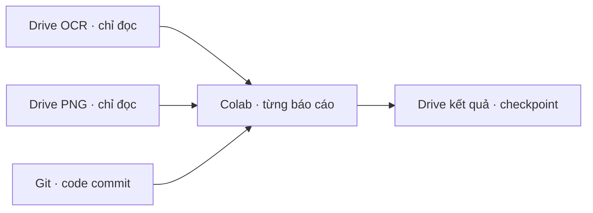

# Module 1 — chạy pilot Drive · Git · Colab

**Trạng thái:** đã tạo runner và notebook; chưa xác nhận một lượt chạy Colab thực tế trong phiên này. Đây là cách triển khai nhánh dữ liệu OCR có sẵn, không thay phạm vi kiến trúc Module 1/C1–C5. Xem [Level 0](00-overview.md), [Module 1](01-document-ingestion.md), [C1](01c-c1-validation.md) và [bàn giao Drive](09-drive-colab-handoff.md).

## Level 0 — luồng và mục đích

Pilot chỉ chọn **BTS, BTW, BPC**. `Financial_Report_OCR` cung cấp JSON OCR; `Financial_Report` cung cấp PNG trang. Hai thư mục nguồn chỉ đọc. Notebook trên Colab lấy code bằng Git, dùng Drive API truy cập file theo ID, tải từng báo cáo vào thư mục tạm của runtime, chạy adapter → OCR quality → normalization bảng kết quả kinh doanh được hỗ trợ → C1, rồi upload artifact vào `multi_agent_financial/module_01_pilot/`. Thư mục tạm được xóa sau mỗi báo cáo. Không tải toàn bộ dataset về máy local.

## Level 1 — đầu vào, đầu ra và resume

**Đầu vào:** ID ba thư mục Drive trong [link_drive.txt](link_drive.txt), quyền Google của runtime Colab, commit Git, `access_scope`, tập mã và năm được chọn. Notebook [00_module1_drive_pilot.ipynb](../colab/00_module1_drive_pilot.ipynb) mặc định chạy mọi năm có trong ba mã pilot; có thể đặt `YEARS = ('2025',)` để thử một năm. Runner từ chối mã ngoài BTS/BTW/BPC. Chạy full các mã khác là công việc riêng theo yêu cầu sau của người dùng.

**Đầu ra mỗi báo cáo:** `manifest.json`, `elements.jsonl`, `drive_source_map.json`, quality report/issues, normalization runs của bảng được hỗ trợ, C1 runs tương ứng và `pilot_summary.json`. `completion.json` được upload **cuối cùng**. Mỗi file trong completion marker có ID và MD5 của Drive. `batch_status.json` ở thư mục pilot tổng hợp báo cáo đã chạy, bỏ qua hoặc lỗi. Source map lưu ID file nguồn; tham chiếu trong adapter vẫn là đường dẫn logic, không là đường dẫn tạm của Colab.

**Resume:** tên run gắn fingerprint metadata của toàn bộ JSON/PNG nguồn, commit Git và config. Khi chạy lại, runner kiểm completion marker và MD5 của từng artifact trên Drive. Chỉ khi chúng khớp mới bỏ qua báo cáo. Nguồn/code/config đổi sẽ tạo run mới; báo cáo lỗi hoặc upload dở được xử lý lại, còn artifact đã upload đúng MD5 được bỏ qua khi upload lại. Kết quả cũ không bị ghi đè bởi run khác phiên bản.

**Phụ thuộc:** Google Colab, OAuth Drive API, `google-api-python-client`, quyền đọc hai folder nguồn và quyền ghi `multi_agent_financial`, GitHub repo sẵn sàng clone/pull. PDF gốc, rule registry production và publish sang C2 chưa được cung cấp qua luồng này.

**Đường lỗi:** trang JSON/PNG thiếu hoặc lệch, checksum không khớp, lỗi xác thực/quota Drive, Colab hết phiên, layout bảng chưa hỗ trợ, hoặc C1 input không hợp lệ. Runner báo lỗi theo từng báo cáo và tiếp tục báo cáo khác. `needs_review`/`unknown` được giữ nguyên; không tự đánh dấu document `ready`.

## Level 2 — hợp đồng và giới hạn

| Thành phần | Hợp đồng |
|---|---|
| Source snapshot | Tập `page_N.json` và `page_N.png` liên tục, cùng số trang; Drive ID/size/MD5/thời gian sửa tạo fingerprint. Adapter kiểm SHA-256 bytes, metadata kích thước, bbox và provenance. |
| Crop/signature | Không tải toàn bộ crop. Đường dẫn logic được giữ với `crop_validation=deferred`; sự tồn tại/chất lượng crop chưa được chứng minh. |
| OCR quality | Kiểm tra xác định trên toàn bộ adapter bundle; ảnh trang chỉ dùng để kiểm hash/kích thước. Độ chính xác ký tự thị giác chưa được đo. |
| FinancialFact | Normalizer v1 chỉ nhận bảng kết quả kinh doanh có tên và header rõ. Metadata kỳ, phạm vi, accounting basis thiếu vẫn ở `needs_review`; không đoán. Bảng khác chưa được chuẩn hóa. |
| C1 | Chạy theo từng normalization run. Không có rule registry đã duyệt nên kết luận pháp lý là `unknown`; sai lệch kế toán không tự thành vi phạm. |
| Quyền và phiên bản | `access_scope` là nhãn đối chiếu của prototype. Tầng retrieval/database về sau phải tự cưỡng chế quyền. Artifact gắn source fingerprint và commit; chưa có cổng publish vào Knowledge Storage/C2. |

**Tech option hiện dùng cho pilot:** Python và Google Drive API trên Colab. Cơ chế đồng bộ dữ liệu khác, OCR PDF mới, chuẩn hóa đủ ba báo cáo tài chính, trích quy định và cổng publish cuối cùng vẫn là việc phải triển khai trong Module 1; không được xem pilot này là hoàn tất toàn bộ kiến trúc đích.
