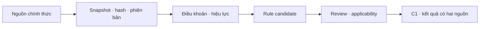

# Module 1 / C1 — nguồn quy định ứng viên cho pilot 2021–2025

**Trạng thái:** danh mục nghiên cứu nguồn chính thức, **chưa phải rule registry đã duyệt**. Tài liệu cha: [Module 1](01-document-ingestion.md), [C1](01c-c1-validation.md); tiến độ dữ liệu: [pilot Colab](10-module-1-colab-pilot.md). Phạm vi pilot chỉ có BTS, BTW, BPC; không suy ra quy định áp dụng từ mã chứng khoán đơn lẻ.

## Level 0 — mục đích và luồng

Module 1 nhận văn bản quy định, giữ bản gốc và phiên bản, trích điều khoản cùng hiệu lực/ngoại lệ, rồi tạo **rule candidate**. C1 chỉ đánh giá một rule khi văn bản, điều khoản, điều kiện áp dụng và chứng cứ báo cáo tương ứng đã được kiểm tra. Kết quả thiếu điều kiện giữ `unknown`; sai lệch số học tự nó không phải kết luận vi phạm pháp luật. Nguồn pháp lý và báo cáo cùng cần provenance; C2 nhận kết quả có phiên bản sau cổng publish. Tầng storage/retrieval/database về sau phải kiểm quyền độc lập với nhãn `access_scope` của pilot.

## Level 1 — nguồn và điều kiện áp dụng

Ngày kiểm tra đường dẫn: **21/10/2026**. Trang CSDL văn bản pháp luật có thể cập nhật trạng thái/quan hệ sửa đổi; mỗi lượt chạy phải chụp lại metadata và văn bản đã dùng, không lấy trạng thái hiện tại áp ngược cho kỳ cũ.

| Nguồn ứng viên | Vai trò dự kiến | Điều kiện cần xác minh trước khi lập rule |
|---|---|---|
| [Luật Kế toán 88/2015/QH13](https://vbpl.vn/binhphuoc/Pages/vbpq-toanvan.aspx?ItemID=95924&Keyword=) | Khung nghĩa vụ kế toán, lập/trình bày/công khai báo cáo. | Điều/khoản cụ thể, sửa đổi theo thời gian, loại đơn vị và chứng cứ đáp ứng nghĩa vụ. |
| [Thông tư 200/2014/TT-BTC](https://vbpl.vn/bovanhoathethao/Pages/vbpq-thuoctinh.aspx?ItemID=66801&Keyword=&dvid=323) và [quan hệ văn bản](https://vbpl.vn/botaichinh/Pages/vbpq-vanbanlienquan.aspx?ItemID=66801&Keyword=&dvid=281) | Chế độ kế toán doanh nghiệp, biểu mẫu và cách trình bày. | Báo cáo thực sự dùng chế độ này; bản sửa đổi có hiệu lực trong từng kỳ 2021–2025; chỉ tiêu và phạm vi hợp nhất/riêng. |
| [Thông tư 133/2016/TT-BTC](https://vbpl.vn/hanoi/Pages/vbpq-van-ban-goc.aspx?ItemID=113560) | Chế độ kế toán doanh nghiệp nhỏ và vừa, nếu được lựa chọn/áp dụng. | Quy mô và chế độ kế toán doanh nghiệp từng năm; không mặc định thay Thông tư 200. |
| [Thông tư 202/2014/TT-BTC](https://vbpl.vn/FileData/TW/Lists/vbpq/Attachments/110994/VanBanGoc_202-2014-TT-BTC_202-2014-TT-BTC.pdf) | Lập và trình bày báo cáo tài chính hợp nhất. | Có quan hệ công ty mẹ–con và báo cáo hợp nhất; không dùng cho báo cáo riêng khi chưa xác minh. |
| [Thông tư 96/2020/TT-BTC](https://vbpl.vn/FileData/TW/Lists/VBPQ/Attachments/146048/VanBanGoc_96-2020-TT-BTC.pdf) cùng [quan hệ sửa đổi](https://vbpl.vn/TW/Pages/vbpq-vanbanlienquan.aspx?ItemID=60241&Keyword=) | Công bố thông tin trên thị trường chứng khoán, hiệu lực từ 01/01/2021 theo Điều 40 của văn bản gốc. | Tư cách đối tượng công bố từng năm, loại báo cáo và thời điểm công bố thực tế; xét sửa đổi 2024/2025 theo ngày hiệu lực từng điều. OCR báo cáo đơn lẻ không chứng minh thời điểm công bố. |

**TBD:** xác nhận danh tính pháp nhân, loại hình/niêm yết, chế độ kế toán và phạm vi báo cáo của từng mã/năm từ nguồn có thẩm quyền; bản hợp nhất hoặc lịch sử sửa đổi chính xác cho từng điều; điều khoản/ngoại lệ và phép kiểm có đủ chứng cứ. Văn bản thay thế có hiệu lực sau kỳ pilot không được áp ngược cho 2021–2025.

## Level 2 — hợp đồng dữ liệu và đường lỗi

Mỗi snapshot cần `document_id`, `document_version`, URL nguồn chính thức, bytes/hash, thời điểm lấy, trạng thái hiệu lực và quan hệ sửa đổi được xác minh. Mỗi điều khoản cần số điều/khoản, text/hash, nguồn trang/đoạn, ngày hiệu lực/bãi bỏ và ngoại lệ. Rule candidate cần loại báo cáo/đối tượng, predicate máy chạy được, version và trạng thái review; `accepted` chỉ sau khi người rà soát xác nhận văn bản **và** cách chuyển điều khoản thành phép kiểm. Một văn bản được tìm thấy chưa chứng minh rule áp dụng cho BTS/BTW/BPC.

| Tình huống | Xử lý |
|---|---|
| Không rõ chế độ kế toán, loại báo cáo hoặc tư cách công bố | `unknown` về applicability; không tạo violation. |
| Điều khoản sửa giữa kỳ hoặc quan hệ sửa đổi chưa rõ | Giữ version riêng và `unknown` cho kỳ bị ảnh hưởng; không áp bản mới ngược thời gian. |
| OCR báo cáo thiếu trang/ô hoặc thiếu PDF gốc | Giữ nguồn JSON/PNG và issue; không tự xác nhận sự vắng mặt của thuyết minh/công bố. PDF gốc sẽ bổ sung sau như một source version riêng. |
| Chỉ có nguồn luật mà không có bằng chứng tài chính hoặc ngược lại | Không phát hành compliance finding; giữ `unknown` với lý do và provenance hiện có. |

**Tech option:** dùng trang/PDF chính thức ở trên để tạo snapshot chỉ đọc, parser trích điều khoản, registry có version và người rà soát. Gemini có thể đề xuất đoạn văn/ánh xạ nhưng không được tự chuyển candidate thành `accepted` hoặc tự quyết định violation. Khóa Gemini chỉ đọc lúc chạy, không ghi vào artifact hay Git.
