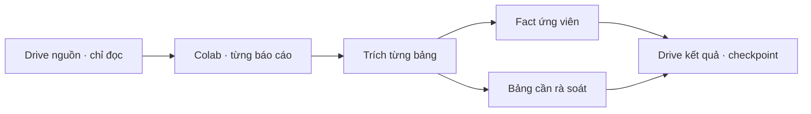

# Module 1 — chịu lỗi OCR và mở rộng batch

Tài liệu này bổ sung [pilot Module 1](10-module-1-colab-pilot.md) và [luồng ingestion](01-document-ingestion.md). Đây là chiến lược triển khai cho nhánh OCR có sẵn; kiến trúc đích C1–C5 trong [Level 0](00-overview.md) vẫn giữ nguyên.

## Level 0 — luồng và mục đích

Mỗi báo cáo là một đơn vị chạy có checkpoint. Mỗi bảng là một đơn vị trích xuất có trạng thái riêng. OCR mơ hồ được ghi vào hàng đợi rà soát, còn fact trích được từ bảng khác vẫn được giữ với `source_ref`, phiên bản nguồn và `needs_review`. `completed` chỉ nói job kỹ thuật đã ghi đủ artifact; nó không có nghĩa dữ liệu đúng, hợp lệ pháp lý hoặc được publish.

## Level 1 — đầu vào, đầu ra và vận hành

**Đầu vào:** tập báo cáo được chọn, OCR adapter artifact đã hoàn thành, source fingerprint, code revision và cấu hình. Hiện batch B01/B03 chỉ nhận 15 báo cáo BTS/BTW/BPC từ pilot; việc chạy hàng nghìn báo cáo cần scheduler chia shard, giới hạn đồng thời và lựa chọn tập báo cáo bằng cấu hình (`TBD`). Không tự mở phạm vi sang toàn bộ Drive nguồn.

**Đầu ra:** mỗi báo cáo có một `statement_candidate_summary.json`, một `financial_facts.jsonl`, một `normalization_issues.jsonl`, rồi `completion.json` ghi cuối cùng. Summary lưu trạng thái từng bảng: `extracted` hoặc `quarantined`; `coverage_status` là `all_detected_tables`, `partial` hoặc `none`. Run có gap vẫn được checkpoint để resume không lặp mãi một OCR/layout không đổi. Khi nguồn, code hoặc config đổi, run mới được tạo; run cũ giữ nguyên.

Lệnh pilot trên Colab: `PYTHONPATH=. python colab/run_statement_candidate_batch.py`. Để kiểm thử một báo cáo dùng thêm `--ticker BPC --year 2021`; trạng thái được ghi vào file selection riêng để không thay `batch_status.json` của batch đầy đủ.

**Đường lỗi:** Drive/auth/checksum/upload lỗi làm **báo cáo** `failed` và có thể retry. Layout/header/ô số không đủ bằng chứng làm **bảng** `quarantined`, ghi lý do; báo cáo có bảng khác vẫn lưu fact của chúng. Thiếu kỳ, phạm vi, đơn vị, PDF gốc hoặc nguồn quy định giữ fact ở `needs_review` và C1 ở `unknown`. Không điền số bằng suy đoán, không chuyển document thành `ready`, không publish C2.

**Phụ thuộc:** Colab, Drive API, artifact OCR có phiên bản, code Git và quyền nguồn/kết quả. Phân quyền ở retrieval/database, rule registry có hiệu lực/ngoại lệ, PDF gốc và provenance kép cần được bổ sung trước các bước publish của kiến trúc đích.

## Level 2 — chính sách xử lý và kiểm tra

| Tình huống | Hành động |
|---|---|
| Bảng có cột và mã chỉ tiêu xác định được | Lưu candidate kèm vị trí trang/ô, số gốc, phiên bản và issue; vẫn `needs_review`. |
| Bảng không đủ bằng chứng | `quarantined` với mã/lý do, không phát sinh fact cho bảng đó. |
| Một bảng lỗi, bảng khác đọc được | `coverage_status=partial`; giữ fact của bảng đọc được. |
| Không bảng nào đọc được | `coverage_status=none`; checkpoint hoàn thành kỹ thuật, đưa vào hàng đợi rà soát. |
| Lỗi hạ tầng hoặc artifact sai checksum | `failed`; retry theo báo cáo, không dùng completion marker chưa hợp lệ. |
| Nguồn/code/config đổi | Run phiên bản mới; resume không nhầm với artifact cũ. |

Kiểm tra mở rộng phải dựa trên **tỷ lệ bảng/báo cáo được trích, tỷ lệ `quarantined`, lỗi theo nguyên nhân, mẫu đối chiếu PNG/PDF và thời gian/chi phí mỗi báo cáo**. Ngưỡng chấp nhận và cách lấy mẫu là `TBD`; không suy ra độ chính xác từ số lượng fact. Sau khi có PDF gốc, cần đối chiếu mẫu và chọn ưu tiên sửa theo **nhóm lỗi phổ biến** thay vì viết ngoại lệ riêng cho từng mã/năm.

### Kết quả batch đầu trên Colab

Ngày 21/10/2026, batch B01/B03 phiên bản đầu hoàn tất 15/15 báo cáo trên Drive 3: 49 bảng được nhận diện, 25 bảng sinh 1.047 fact ứng viên, 24 bảng không sinh fact. BTW/2021–2023 có 0 fact B01/B03; lý do chủ yếu là không xác định được cặp header hiện tại/kỳ trước, một số bảng không có hàng số rõ. BPC/2021–2025 có fact B03 nhưng B01 thiếu cặp header. Các fact đều cần rà soát. Batch đầu chỉ ghi `processed` ở cấp báo cáo; trạng thái coverage và gộp artifact theo báo cáo là **code mới, chưa chạy lại trên Colab** tại thời điểm ghi tài liệu này.
