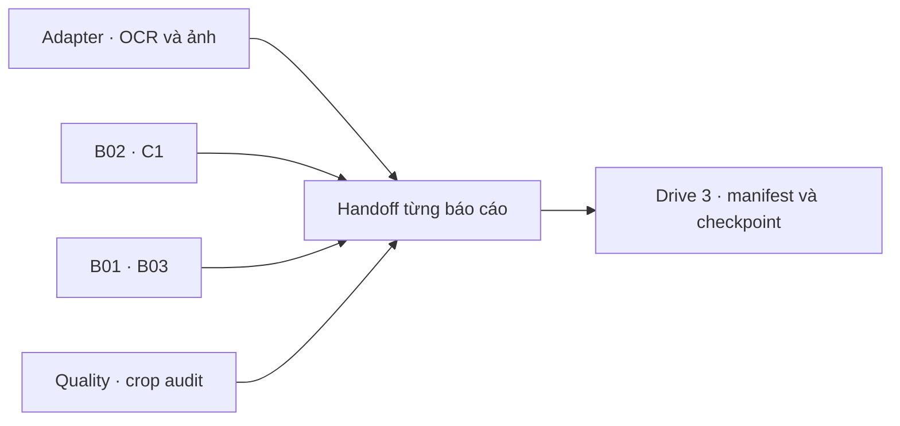

# Module 1 — hợp đồng bàn giao pilot cho module sau

Tài liệu con của [pilot Module 1](10-module-1-colab-pilot.md) và [chính sách chịu lỗi](12-module-1-resilience.md). Chỉ mô tả nhánh OCR lịch sử của BTS, BTW, BPC giai đoạn 2021–2025. Kiến trúc đích C1–C5 vẫn theo [Level 0](00-overview.md); gói này chưa phải publish vào Knowledge Storage/C2 hay dữ liệu đã xác minh.

## Level 0 — luồng và mục đích

Job bàn giao **chỉ đọc artifact đã có trên Drive 3**. Nó ghép tham chiếu OCR text/bảng, ảnh trang, quality, fact ứng viên B02, B01/B03, C1 và audit crop thành một `handoff.json` theo từng báo cáo. Module 3 có thể đọc lại OCR gốc khi bảng không trích được fact; mọi con số ứng viên vẫn phải qua kiểm chứng nguồn trước khi dùng làm claim.

## Level 1 — đầu vào, đầu ra và vận hành

**Đầu vào:** `batch_status.json` của 15 báo cáo adapter, các batch status bổ sung của B02 và B01/B03, completion marker cùng metadata artifact trên Drive 3. Job chọn run B02 có nhiều fact ứng viên nhất **trong cùng source fingerprint**; với B01/B03 ưu tiên batch version mới hơn, vẫn phải khớp fingerprint của adapter `manifest.json` và `elements.jsonl`. Mỗi component giữ `code_revision` và Drive ID riêng; không giả định các lần chạy cùng phiên bản code.

**Đầu ra:** `module_01_pilot/handoff/<ticker>/<year>/run-.../handoff.json` và `completion.json` ghi sau cùng. `module_01_pilot/handoff/batch_status.json` ghi trạng thái 15 báo cáo. Job kiểm ID/MD5 của nguồn adapter và các file kết quả được tham chiếu. Chạy lại cùng nguồn, code và cấu hình trả `skipped_completed` khi artifact còn hợp lệ.

**Phụ thuộc:** Colab, Drive API, Git và quyền đọc artifact Drive 3, quyền ghi thư mục kết quả Drive 3. Lệnh tại root repo trong Colab: `PYTHONPATH=. python colab/run_pilot_handoff.py`. Job không tải lại JSON/PNG nguồn và không sửa Drive 1 hoặc Drive 2.

**Đường lỗi:** thiếu/mất checksum của `manifest.json`, `elements.jsonl` hoặc `drive_source_map.json` làm báo cáo `failed` và có thể retry. Thiếu bảng/fact ứng viên làm báo cáo vẫn có `handoff.json` với cảnh báo; OCR gốc vẫn truy được. Lỗi quyền/API tạm thời làm báo cáo `failed`, không ghi completion marker thành công.

## Level 2 — contract của `handoff.json`

| Nhóm | Nội dung |
|---|---|
| Định danh | `ticker`, `year`, `document_id`, `document_version`, `source_fingerprint`, `access_scope`, `page_count`. |
| Nguồn OCR | `adapter_artifacts`: `manifest.json`, `elements.jsonl` chứa OCR text/bảng/ô và `drive_source_map.json` ánh xạ ảnh/JSON trang tới Drive ID nguồn. |
| Chất lượng | `quality_artifacts`, `ocr_review_issue_count`, `warnings`, `crop_audit` nếu có. Crop audit chỉ kiểm metadata, không xác thực nội dung ảnh/chữ ký. |
| Dữ liệu tài chính | `b02` và `b01_b03` có run folder, code revision, số fact ứng viên, trạng thái bảng và các file fact/issue được tham chiếu. Thành phần có thể `null` khi không có run khớp nguồn. |
| C1 và publish | `legal_compliance_status=unknown`, `ingestion_status=needs_review`, `knowledge_storage_published=false`, `original_pdf_ref=null` cho bộ đầu vào hiện có. |

Mỗi file tham chiếu gồm `drive_file_id`, `md5`, `size`; consumer phải kiểm `access_scope` của người dùng tại tầng retrieval/database. `handoff_status=completed_with_warnings` chỉ xác nhận gói bàn giao kỹ thuật đã tạo. Module 3 có thể dùng OCR gốc để diễn giải, nhưng C4 phải kiểm nguồn và có quyền `ABSTAIN` nếu bằng chứng không đủ. Quy định pháp lý cần rule registry có hiệu lực, ngoại lệ và nguồn điều khoản trước khi có compliance finding; C1 hiện chưa có căn cứ đó.

## Kết quả thực chạy

Ngày 21/10/2026, job Colab tạo [thư mục handoff trên Drive 3](https://drive.google.com/drive/folders/1SvEPX4Ompy79ltJEHoNYaW3NlXUiYbWi) cho **15/15** báo cáo, không có report `failed`. Script [inspect_pilot_handoff.py](../colab/inspect_pilot_handoff.py) đọc lại 15 `handoff.json` và xác nhận **15/15 completion marker hợp lệ cùng checksum artifact**. Gói bàn giao tham chiếu 544 fact ứng viên B02 và 1.047 fact ứng viên B01/B03 từ các run có phiên bản được ghi riêng, không cộng chúng thành fact đã xác minh.

Cả 15 báo cáo còn OCR review issue. Có 9 báo cáo với ít nhất một bảng B01/B03 cần rà soát; BTW/2021, BTW/2022 và BTW/2023 chưa có fact B01/B03 nhưng vẫn bàn giao `elements.jsonl` cùng ảnh trang qua source map. Đây là **hoàn thành bàn giao kỹ thuật cho pilot**, còn `ingestion_status=needs_review`, C1 pháp lý `unknown`, PDF gốc chưa có và chưa publish Knowledge Storage/C2.
